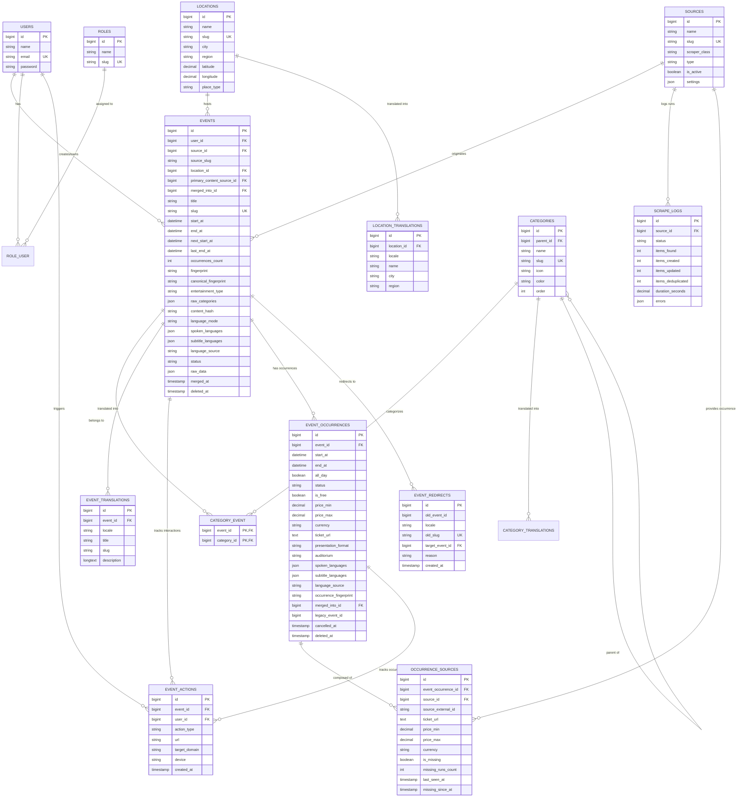

# Sodiena.lv Datubāzes Struktūras un Datu Modeļa Dokumentācija (DB_readme.md)

Šis dokuments sniedz pilnīgu un padziļinātu pārskatu par **Sodiena.lv** ražošanas (Production) relāciju datubāzes shēmu, modeļiem, tabulu struktūrām, indeksiem, ārējām saitēm un biznesa loģikas konvencijām, balstoties uz produkcijas MySQL dump (`sodiena.sql`, 2026-11-27).

---

## 1. Vispārīga Informācija un Arhitektūra

* **Datubāzes dzinējs:** MySQL 8.0+ / MariaDB 10.5+
* **Noklusētais tabulu dzinējs:** `InnoDB` (atbalsta ACID transakcijas un ārējās atslēgas)
* **Kodējums un salīdzināšana:** `utf8mb4` ar `utf8mb4_unicode_ci` (pilns UTF-8 atbalsts, tostarp latviešu diakritiskajām zīmēm un emocijzīmēm)
* **ORM:** Laravel 11 Eloquent
* **Kopējais tabulu skaits:** 24 tabulas (1. posma DB v2 shēmas paplašinājums: `events` + `event_occurrences` + `occurrence_sources` + `event_redirects`)
* **Produkcijas datu apjoms (2026-11-27):**
  * Pasākumi (`events`): ~19 632 ieraksti (no kuriem ~192 melnraksti, ~19 440 publicēti)
  * Tulkojumi (`event_translations`): ~58 477 ieraksti (trīs valodas: `lv` 19 621, `ru` 19 430, `en` 19 426)
  * Norises vietas (`locations`): ~3 386 unikālas vietas
  * Vietu tulkojumi (`location_translations`): ~7 506 ieraksti
  * Pasākumu sasaiste ar kategorijām (`category_event`): ~26 212 saites
  * Datu avoti (`sources`): 63 integrēti un reģistrēti skreiperi / avoti
  * Skreipošanas žurnāls (`scrape_logs`): ~1 633 sesijas
  * Lietotāju darbības / klikšķi (`event_actions`): ~25 ieraksti
  * Lietotāji (`users`): 10 lietotāji (administratori un operatori)
  * Valodu pārklājums (`language_mode`): `language_free`: 3 948, `spoken`: 3 930, `unknown`: 11 754

---

## 2. Entītiju Relāciju Diagramma (ERD)



---

## 3. Detalizēts Tabulu un Datu Modeļa Apraksts

Tabulas ir sagrupētas 6 loģiskajos domēnos:
1. [Pasākumi un Saturs](#1-pasākumi-un-saturs)
2. [Norises Vietas un Lokācijas](#2-norises-vietas-un-lokācijas)
3. [Klasifikācija un Kategorijas](#3-klasifikācija-un-kategorijas)
4. [Datu Avoti un Skreipošanas Žurnāls](#4-datu-avoti-un-skreipošanas-žurnāls)
5. [Lietotāji, Lomas un Drošība](#5-lietotāji-lomas-un-drošība)
6. [Analītika, Clicks un Izsekošana](#6-analītika-clicks-un-izsekošana)
7. [Sistēmas, Rindas un Kešatmiņas Tabulas](#7-sistēmas-rindas-un-kešatmiņas-tabulas)

---

### 1. Pasākumi un Saturs

#### 1.1. Tabula: `events`
Centrālā sistēmas tabula, kurā glabājas visi pasākumi, koncerti, kino seansi, festivāli, sporta spēles un izstādes.

| Kolonna | Datu tips | Nullable | Noklusētā | Apraksts |
| :--- | :--- | :---: | :--- | :--- |
| `id` | `BIGINT UNSIGNED` | Nē | AUTO_INCREMENT | Pasākuma unikālais identifikators (PK). |
| `user_id` | `BIGINT UNSIGNED` | Jā | `NULL` | Atsauce uz lietotāju, ja pasākumu ievietojis reģistrēts lietotājs (FK uz `users.id`). |
| `source_id` | `BIGINT UNSIGNED` | Jā | `NULL` | Primārais skreipera/avota ID (FK uz `sources.id`). |
| `source_slug` | `VARCHAR(50)` | Jā | `NULL` | Avota īsais identifikators (`apollo-kino`, `basket-lv`, `afiro-api`, `bilesu-paradize` utt.). |
| `location_id` | `BIGINT UNSIGNED` | Jā | `NULL` | Atsauce uz norises vietu (FK uz `locations.id`). |
| `title` | `VARCHAR(255)` | Nē | | Kanoniskais pasākuma nosaukums latviešu valodā. |
| `slug` | `VARCHAR(255)` | Nē | | URL draudzīgs unikāls identifikators (ar pievienotu 6 zīmju unikālu hešu, piem., `nosaukums-aBcDeF`). |
| `description` | `LONGTEXT` | Jā | `NULL` | Pilns pasākuma apraksts (HTML vai formatēts teksts). |
| `short_description`| `TEXT` | Jā | `NULL` | Īss apraksts priekšskatījuma kartītēm un sociālajiem tīkliem (līdz ~160-250 zīmēm). |
| `start_at` | `DATETIME` | Jā | `NULL` | Pasākuma sākuma datums un laiks (ar laika joslu Rīga/Europe). v2 shēmā var būt NULL kanoniskajam pasākumam pirms seansu piesaistes. |
| `end_at` | `DATETIME` | Jā | `NULL` | Pasākuma beigu datums un laiks (ja zināms). |
| `next_start_at` | `DATETIME` | Jā | `NULL` | Denormalizēts tuvākās aktīvās norises (`event_occurrences`) sākuma laiks ātrai filtrēšanai. |
| `last_end_at` | `DATETIME` | Jā | `NULL` | Denormalizēts pēdējās aktīvās norises beigu laiks. |
| `occurrences_count`| `INT UNSIGNED` | Nē | `0` | Aktīvo nākotnes norišu kopskaits. |
| `all_day` | `TINYINT(1)` | Nē | `0` | Karodziņš, vai pasākums ir visas dienas garumā (bez konkrēta pulksteņa laika). |
| `is_free` | `TINYINT(1)` | Nē | `0` | Karodziņš, vai pasākuma apmeklējums ir bez maksas. |
| `price_min` | `DECIMAL(8,2)` | Jā | `NULL` | Minimālā biļetes cena EUR. |
| `price_max` | `DECIMAL(8,2)` | Jā | `NULL` | Maksimālā biļetes cena EUR. |
| `currency` | `VARCHAR(10)` | Nē | `'EUR'` | Cenas valūta. |
| `ticket_url` | `TEXT` | Jā | `NULL` | Tiešā saite uz biļešu iegādi (kanoniskais biļešu tirgotājs). |
| `image_url` | `TEXT` | Jā | `NULL` | Sākotnējā ārējā attēla URL no avota. |
| `internal_image_url`| `TEXT` | Jā | `NULL` | Lokāli kešots un Hetzner S3/lokālajā glabātuvē optimizēts WebP attēla ceļš. |
| `source_url` | `TEXT` | Jā | `NULL` | Oriģinālā tīmekļa vietnes adrese, no kuras iegūta informācija. |
| `source_external_id`| `VARCHAR(255)`| Jā | `NULL` | Oriģinālais identifikators avota sistēmā (ID, seansa kods vai hešs). |
| `primary_content_source_id`| `BIGINT UNSIGNED`| Jā | `NULL` | Avots, no kura vienoti ņemts virsraksts un apraksts (FK uz `sources.id`). |
| `fingerprint` | `VARCHAR(64)` | Jā | `NULL` | v1 hešs deduplikācijai ar datumu: `md5(title + date + location_id)`. |
| `canonical_fingerprint` | `VARCHAR(64)` | Jā | `NULL` | v2 vietas un nosaukuma hešs bez datuma: `sha256(norm_title + location_id)`. |
| `entertainment_type`| `VARCHAR(255)`| Jā | `NULL` | Atpūtas/izklaides veids (`chill`, `performance`, `concert`, `exhibition`, `sports`, `workshop`, `kino`, `kids`, `event`, `other`). |
| `raw_categories` | `JSON` | Jā | `NULL` | Apvienotas unikālās izejas kategorijas no aktīvajiem avotiem (eksportam uz Piedzivo.lv). |
| `content_hash` | `VARCHAR(64)` | Jā | `NULL` | Kanoniskā satura + norišu SHA-256 hešs delta sync kontrolei. |
| `language_mode` | `VARCHAR(20)` | Nē | `'unknown'` | Pasākuma valodas režīms: `'spoken'`, `'language_free'`, `'unknown'`. |
| `spoken_languages` | `JSON` | Nē | `(JSON_ARRAY())` | Runāto valodu ISO 639-1 kodu masīvs (piem., `["lv", "en"]`). |
| `subtitle_languages` | `JSON` | Nē | `(JSON_ARRAY())` | Subtitru valodu ISO 639-1 kodu masīvs (piem., `["en"]`). |
| `language_source` | `VARCHAR(20)` | Nē | `'unknown'` | Valodas datu izcelsmes uzticamība: `'manual'`, `'explicit'`, `'inferred'`, `'unknown'`. |
| `status` | `VARCHAR(30)` | Nē | `'draft'` | Publicēšanas statuss: `'published'`, `'draft'`, `'archived'`, `'cancelled'`, `'merged'`, `'deleted'`. |
| `merged_into_id` | `BIGINT UNSIGNED` | Jā | `NULL` | FK uz `events.id` `ON DELETE SET NULL` (tombstone norāde sapludinātajiem pasākumiem). |
| `merged_at` | `TIMESTAMP` | Jā | `NULL` | Sapludināšanas laika zīmogs. |
| `published_at` | `TIMESTAMP` | Jā | `NULL` | Brīdis, kad pasākums tika publicēts un kļuva redzams lietotājiem. |
| `is_featured` | `TINYINT(1)` | Nē | `0` | Rekomendēts/izcelts pasākums sākumlapas galvenajā blokā. |
| `is_promoted` | `TINYINT(1)` | Nē | `0` | Sponsorēts/maksas izcelts pasākums rezultātu saraksta augšgalā. |
| `views_count` | `BIGINT UNSIGNED`| Nē | `0` | Kopējais pasākuma lapas skatījumu skaitītājs. |
| `raw_data` | `JSON` | Jā | `NULL` | Papildus strukturētie dati un metadatu maiss (skatīt zemāk). |
| `created_at` | `TIMESTAMP` | Jā | `NULL` | Izveidošanas laiks. |
| `updated_at` | `TIMESTAMP` | Jā | `NULL` | Pēdējās modifikācijas laiks. |
| `deleted_at` | `TIMESTAMP` | Jā | `NULL` | Soft-delete atzīme. Ja nav NULL, pasākums ir paslēpts / dzēsts. |

**CHECK Ierobežojumi (MySQL 8.0.16+):**
* `check_events_language_mode`: `CHECK (language_mode IN ('spoken', 'language_free', 'unknown'))`
* `check_events_language_source`: `CHECK (language_source IN ('manual', 'explicit', 'inferred', 'unknown'))`
* `check_events_spoken_languages_array`: `CHECK (JSON_TYPE(spoken_languages) = 'ARRAY')`
* `check_events_subtitle_languages_array`: `CHECK (JSON_TYPE(subtitle_languages) = 'ARRAY')`
* `check_events_status`: `CHECK (status IN ('published', 'draft', 'archived', 'cancelled', 'merged', 'deleted'))`
* `check_events_raw_categories_array`: `CHECK (raw_categories IS NULL OR JSON_TYPE(raw_categories) = 'ARRAY')`

**Ārējās atslēgas (Foreign Keys):**
* `events_source_id_foreign`: `source_id` -> `sources(id)` `ON DELETE SET NULL`
* `events_location_id_foreign`: `location_id` -> `locations(id)` `ON DELETE SET NULL`
* `events_user_id_foreign`: `user_id` -> `users(id)` `ON DELETE SET NULL`
* `fk_events_primary_content_source`: `primary_content_source_id` -> `sources(id)` `ON DELETE SET NULL`
* `fk_events_merged_into_id`: `merged_into_id` -> `events(id)` `ON DELETE SET NULL`

**Indeksi (Indexes):**
* `PRIMARY KEY (id)`
* `KEY events_slug_index (slug)`
* `KEY events_fingerprint_index (fingerprint)`
* `KEY events_start_at_index (start_at)`
* `KEY events_end_at_index (end_at)`
* `KEY events_status_index (status)`
* `KEY events_status_start_at_index (status, start_at)` (Kritisks ātrai aktuālo pasākumu filtrēšanai)
* `KEY idx_events_language_mode (language_mode)` (B-Tree ātrai valodas režīma atlasei)
* `KEY idx_events_language_source (language_source)` (B-Tree ātrai `unknown` ierakstu atlasei backfill procesam)
* `KEY idx_events_status_language_mode (status, language_mode)` (Kompozītais indekss publisko pasākumu filtrēšanai)
* `KEY idx_events_spoken_languages_mv ((CAST(spoken_languages AS CHAR(10) ARRAY)))` (MySQL 8.0 Multi-Valued JSON indekss)
* `KEY idx_events_subtitle_languages_mv ((CAST(subtitle_languages AS CHAR(10) ARRAY)))` (MySQL 8.0 Multi-Valued JSON indekss)
* `KEY idx_events_location_canonical_fp (location_id, canonical_fingerprint)` (Galvenais v2 deduplikācijas indekss vietas ietvaros)
* `KEY idx_events_merged_into_id (merged_into_id)`
* `KEY idx_events_status_next_start (status, next_start_at)` (Ātra v2 publiskā kataloga atlase)
* `KEY idx_events_sync_cursor (updated_at, id)` (Deterministiska inkrementālās sinhronizācijas paginācija priekš Piedzivo.lv)
* `KEY idx_events_primary_content_source (primary_content_source_id)`
* `KEY events_is_promoted_index (is_promoted)`
* `KEY events_is_featured_index (is_featured)`
* `KEY events_is_free_index (is_free)`
* `KEY events_source_slug_index (source_slug)`
* `KEY events_source_external_id_index (source_external_id)`
* `KEY events_entertainment_type_index (entertainment_type)`
* `KEY events_published_at_index (published_at)`
* `KEY events_deleted_at_index (deleted_at)`

##### JSON Kolonnas `raw_data` Struktūra:
Lauks `raw_data` kalpo kā elastīgs datu maiss avota specifiskajiem atribūtiem:
```json
{
  "ticket_links": [
    {
      "url": "https://www.bilesuserviss.lv/...",
      "title": "bilesuserviss.lv"
    }
  ],
  "merged_external_ids": {
    "afiro-api": "a7ts2k11awu4swo76x4pp290",
    "bilesu-serviss": "bilesuserviss-I2PU3IJQ3B"
  },
  "organizer": {
    "name": "SIA Lielais Notikums",
    "email": "info@organizer.lv",
    "phone": "+371 20000000"
  },
  "cinema": {
    "chain": "apollo-kino",
    "theatre_id": 1035,
    "theatre": "Apollo Kino Akropole Rīga",
    "auditorium": "1. IMAX zāle",
    "session_id": "534975",
    "presentation_method": "IMAX 2D",
    "presentation_format": "IMAX 2D",
    "spoken_language_raw": {
      "Name": "Latviešu",
      "NameInLanguage": "Latviešu",
      "ISOTwoLetterCode": "lv"
    },
    "subtitle_languages_raw": []
  },
  "sports": {
    "home_team": "Daugavpils Universitāte",
    "away_team": "TTT Rīga Kadetes",
    "league": "BioSil SBBL"
  }
}
```

> [!NOTE]
> **Kino Seansu API Serializācija (`EventResource`):**  
> Pasākumu API resursā (`EventResource`) kinoteātru seansiem tiek nodots objekts `cinema` ar abām formāta atslēgām: `presentation_method` un `presentation_format` (alias). Tas nodrošina 100% savietojamību ar Markus XML oriģinālo `<PresentationMethod>` un patērētāju (piem., *Piedzivo.lv*) datu normalizatoru, kas atpazīst IMAX, 3D, LUX (`DELFI LUX aud.`, `4 LUX aud.`), ISENSE un VIP zāles.

---

#### 1.2. Tabula: `event_translations`
Glabā lokalizētu saturu visām atbalstītajām valodām (`lv`, `en`, `ru`).

| Kolonna | Datu tips | Nullable | Noklusētā | Apraksts |
| :--- | :--- | :---: | :--- | :--- |
| `id` | `BIGINT UNSIGNED` | Nē | AUTO_INCREMENT | Primārā atslēga. |
| `event_id` | `BIGINT UNSIGNED` | Nē | | Atsauce uz pasākumu (FK uz `events.id`). |
| `locale` | `VARCHAR(10)` | Nē | | Valodas kods: `'lv'`, `'en'` vai `'ru'`. |
| `title` | `VARCHAR(255)` | Nē | | Pasākuma tulkotais nosaukums konkrētajā valodā. |
| `slug` | `VARCHAR(255)` | Nē | | Lokalizēts unikāls URL slug konkrētajai valodai. |
| `description` | `LONGTEXT` | Jā | `NULL` | Pilns lokalizētais apraksts. |
| `short_description`| `TEXT` | Jā | `NULL` | Lokalizēts īsais apraksts. |
| `created_at` | `TIMESTAMP` | Jā | `NULL` | Izveidošanas laiks. |
| `updated_at` | `TIMESTAMP` | Jā | `NULL` | Pēdējās modifikācijas laiks. |

**Ierobežojumi un Indeksi:**
* `PRIMARY KEY (id)`
* `UNIQUE KEY event_translations_event_id_locale_unique (event_id, locale)` (Novērš dublikātus vienai valodai vienam pasākumam)
* `KEY event_translations_locale_index (locale)`
* `KEY event_translations_slug_index (slug)`
* `CONSTRAINT event_translations_event_id_foreign`: `event_id` -> `events(id)` `ON DELETE CASCADE`

---

#### 1.3. Tabula: `event_occurrences`
Reprezentē konkrētas pasākuma norises (seansus, izrādes datumus, spēles, koncerta norises). Identifikators `event_occurrences.id` kalpo kā 1:1 ārējā atslēga sinhronizācijā ar *Piedzivo.lv*.

| Kolonna | Datu tips | Nullable | Noklusētā | Apraksts |
| :--- | :--- | :---: | :--- | :--- |
| `id` | `BIGINT UNSIGNED` | Nē | AUTO_INCREMENT | Primārā atslēga. |
| `event_id` | `BIGINT UNSIGNED` | Nē | | Atsauce uz pamatpasākumu (FK uz `events.id` `ON DELETE CASCADE`). |
| `start_at` | `DATETIME` | Nē | | Norises sākuma datums un laiks (`Europe/Riga`). |
| `end_at` | `DATETIME` | Jā | `NULL` | Norises beigu datums un laiks. |
| `all_day` | `TINYINT(1)` | Nē | `0` | Visas dienas pasākums bez precīza sākuma laika. |
| `status` | `VARCHAR(30)` | Nē | `'scheduled'` | Norises statuss (`scheduled`, `postponed`, `cancelled`, `completed`, `merged`, `deleted`). |
| `is_free` | `TINYINT(1)` | Nē | `0` | Vai konkrētā norise ir bezmaksas. |
| `price_min` | `DECIMAL(8,2)` | Jā | `NULL` | Minimālā biļetes cena (aprēķināta no aktīvajiem `occurrence_sources`). |
| `price_max` | `DECIMAL(8,2)` | Jā | `NULL` | Maksimālā biļetes cena. |
| `currency` | `VARCHAR(10)` | Nē | `'EUR'` | Valūtas kods. |
| `ticket_url` | `TEXT` | Jā | `NULL` | Deterministiski aprēķinātais labākais aktīvais biļešu iegādes URL. |
| `presentation_format` | `VARCHAR(50)` | Jā | `NULL` | Seansa formāts (`2D`, `3D`, `IMAX 2D`, `LUX`, `Dolby Atmos`). |
| `auditorium` | `VARCHAR(120)` | Jā | `NULL` | Zāles/auditorijas nosaukums (`1. IMAX zāle`, `DELFI LUX aud.`, `Lielā zāle`). |
| `spoken_languages` | `JSON` | Jā | `NULL` | Norises runātās valodas (ISO 639-1). `NULL` = manto no `events`, `[]` = eksplicīti nav valodas barjeras. |
| `subtitle_languages` | `JSON` | Jā | `NULL` | Norises subtitru valodas (ISO 639-1). `NULL` = manto no `events`, `[]` = eksplicīti bez subtitriem. |
| `language_source` | `VARCHAR(20)` | Jā | `NULL` | Valodas avota ticamība (`manual`, `explicit`, `inferred`, `unknown`, vai `NULL` mantošanai). |
| `occurrence_fingerprint` | `VARCHAR(64)` | Nē | | SHA-256 hešs: `event_id \| start_at \| norm_format \| norm_auditorium`. |
| `merged_into_id` | `BIGINT UNSIGNED` | Jā | `NULL` | FK uz `event_occurrences.id` `ON DELETE SET NULL` (tombstone norises sapludināšanai). |
| `legacy_event_id` | `BIGINT UNSIGNED` | Jā | `NULL` | Vecā plakanā `events.id` vērtība 1:1 migrācijas tiltam uz *Piedzivo.lv* (bez FK). |
| `cancelled_at` | `TIMESTAMP` | Jā | `NULL` | Laiks, kad norise atzīmēta kā atcelta. |
| `created_at` | `TIMESTAMP` | Jā | `NULL` | Izveidošanas laiks. |
| `updated_at` | `TIMESTAMP` | Jā | `NULL` | Pēdējās modifikācijas laiks. |
| `deleted_at` | `TIMESTAMP` | Jā | `NULL` | Soft-delete atzīme. |

**CHECK Ierobežojumi (MySQL 8.0.16+):**
* `check_eo_status`: `CHECK (status IN ('scheduled', 'postponed', 'cancelled', 'completed', 'merged', 'deleted'))`
* `check_eo_language_source`: `CHECK (language_source IS NULL OR language_source IN ('manual', 'explicit', 'inferred', 'unknown'))`
* `check_eo_spoken_languages_array`: `CHECK (spoken_languages IS NULL OR JSON_TYPE(spoken_languages) = 'ARRAY')`
* `check_eo_subtitle_languages_array`: `CHECK (subtitle_languages IS NULL OR JSON_TYPE(subtitle_languages) = 'ARRAY')`

**Ārējās atslēgas un Indeksi:**
* `PRIMARY KEY (id)`
* `CONSTRAINT fk_eo_event_id`: `event_id` -> `events(id)` `ON DELETE CASCADE`
* `CONSTRAINT fk_eo_merged_into_id`: `merged_into_id` -> `event_occurrences(id)` `ON DELETE SET NULL`
* `KEY idx_eo_event_status_start (event_id, status, start_at)`
* `KEY idx_eo_status_start (status, start_at)`
* `KEY idx_eo_fingerprint (occurrence_fingerprint)`
* `KEY idx_eo_merged_into (merged_into_id)`
* `KEY idx_eo_deleted_at (deleted_at)`
* `UNIQUE KEY uq_eo_legacy_event_id (legacy_event_id)`

---

#### 1.4. Tabula: `occurrence_sources`
Avotu slānis, kas aizstāj kļūdu riskanto `raw_data.merged_external_ids` un `raw_data.ticket_links` uzkrāšanu vienā JSON laukā. Katrs avots uztur tikai savu rindu; kanoniskie lauki (`events` un `event_occurrences`) tiek deterministiski aprēķināti no aktīvajām (`is_missing = 0`) rindām pēc `SourceType` prioritātes.

| Kolonna | Datu tips | Nullable | Noklusētā | Apraksts |
| :--- | :--- | :---: | :--- | :--- |
| `id` | `BIGINT UNSIGNED` | Nē | AUTO_INCREMENT | Primārā atslēga. |
| `event_occurrence_id` | `BIGINT UNSIGNED`| Nē | | FK uz `event_occurrences.id` `ON DELETE CASCADE`. |
| `source_id` | `BIGINT UNSIGNED` | Nē | | FK uz `sources.id` `ON DELETE CASCADE`. |
| `source_external_id` | `VARCHAR(255)` | Nē | | Unikālais ieraksta ID avota sistēmā (piem., `show_32891`, `140231`). |
| `source_url` | `TEXT` | Jā | `NULL` | Oriģinālā pasākuma lapas adrese avotā. |
| `ticket_url` | `TEXT` | Jā | `NULL` | Tikai šī avota biļešu iegādes URL. |
| `price_min` | `DECIMAL(8,2)` | Jā | `NULL` | Šī avota minimālā cena. |
| `price_max` | `DECIMAL(8,2)` | Jā | `NULL` | Šī avota maksimālā cena. |
| `currency` | `VARCHAR(10)` | Nē | `'EUR'` | Valūtas kods. |
| `is_free` | `TINYINT(1)` | Jā | `NULL` | Šī avota bezmaksas pazīme (`NULL`, ja avots nenorāda). |
| `raw_title` | `VARCHAR(255)` | Jā | `NULL` | Šī avota oriģinālais virsraksts. |
| `raw_description` | `LONGTEXT` | Jā | `NULL` | Šī avota oriģinālais apraksts. |
| `raw_image_url` | `TEXT` | Jā | `NULL` | Šī avota afišas URL. |
| `raw_categories` | `JSON` | Jā | `NULL` | Neapstrādātās avota kategorijas/žanri (`$dto->categoryNames`). |
| `raw_payload` | `JSON` | Jā | `NULL` | Avota specifiskie metadati (`cinema`, `language`, `sports`, `organizer`). |
| `content_hash` | `VARCHAR(64)` | Jā | `NULL` | SHA-256 hešs nemainītu DTO izlaišanai. |
| `last_scrape_log_id` | `BIGINT UNSIGNED`| Jā | `NULL` | FK uz `scrape_logs.id` `ON DELETE SET NULL` (reconciliation sasaistei). |
| `last_seen_at` | `TIMESTAMP` | Nē | `CURRENT_TIMESTAMP` | Pēdējā reize, kad skreiperis ieraudzīja šo ierakstu. |
| `is_missing` | `TINYINT(1)` | Nē | `0` | `1`, ja avots pilnajā ciklā šo ierakstu vairs neatgriež. |
| `missing_runs_count` | `TINYINT UNSIGNED`| Nē | `0` | Secīgo pilno ciklu skaits, kuros ieraksts trūkst. |
| `missing_since_at` | `TIMESTAMP` | Jā | `NULL` | Brīdis, kad pazušana pirmo reizi fiksēta. |
| `created_at` | `TIMESTAMP` | Jā | `NULL` | Izveidošanas laiks. |
| `updated_at` | `TIMESTAMP` | Jā | `NULL` | Pēdējās modifikācijas laiks. |

**CHECK Ierobežojumi (MySQL 8.0.16+):**
* `check_occ_src_raw_categories_array`: `CHECK (raw_categories IS NULL OR JSON_TYPE(raw_categories) = 'ARRAY')`

**Ārējās atslēgas un Indeksi:**
* `PRIMARY KEY (id)`
* `CONSTRAINT fk_occ_src_occurrence_id`: `event_occurrence_id` -> `event_occurrences(id)` `ON DELETE CASCADE`
* `CONSTRAINT fk_occ_src_source_id`: `source_id` -> `sources(id)` `ON DELETE CASCADE`
* `CONSTRAINT fk_occ_src_scrape_log_id`: `last_scrape_log_id` -> `scrape_logs(id)` `ON DELETE SET NULL`
* `UNIQUE KEY uq_occ_sources_ext (source_id, source_external_id)` (O(1) avota ieraksta atrašana)
* `KEY idx_occ_sources_occurrence (event_occurrence_id, is_missing)` (Ātra aktīvo avotu atlase kanonisko lauku pārrēķinam)
* `KEY idx_occ_sources_reconcile (source_id, is_missing, last_scrape_log_id)` (Zibenīga pazudušo seansu atlase reconciliation solī)

---

#### 1.5. Tabula: `event_redirects`
Nodrošina nepārtrauktu `301 Moved Permanently` pāradresāciju visās valodās (`lv`, `en`, `ru`) gan vienreizējās v2 datu migrācijas laikā, gan turpmāko deduplikācijas sapludināšanu gadījumos.

| Kolonna | Datu tips | Nullable | Noklusētā | Apraksts |
| :--- | :--- | :---: | :--- | :--- |
| `id` | `BIGINT UNSIGNED` | Nē | AUTO_INCREMENT | Primārā atslēga. |
| `old_event_id` | `BIGINT UNSIGNED` | Jā | `NULL` | Vecā sapludinātā pasākuma ID (bez FK, saglabājas audits). |
| `locale` | `VARCHAR(10)` | Nē | `'lv'` | Valodas kods (`lv`, `en`, `ru`). |
| `old_slug` | `VARCHAR(255)` | Nē | | Vecais lokalizētais vai pamat-slug. |
| `target_event_id` | `BIGINT UNSIGNED` | Nē | | FK uz `events.id` `ON DELETE CASCADE` (galīgais kanoniskais mērķis). |
| `reason` | `VARCHAR(30)` | Nē | `'merged'` | Pāradresācijas iemesls (`migrated`, `merged`, `slug_changed`). |
| `created_at` | `TIMESTAMP` | Nē | `CURRENT_TIMESTAMP` | Izveidošanas laiks. |

**CHECK Ierobežojumi (MySQL 8.0.16+):**
* `check_event_redirects_reason`: `CHECK (reason IN ('migrated', 'merged', 'slug_changed'))`

**Ārējās atslēgas un Indeksi:**
* `PRIMARY KEY (id)`
* `CONSTRAINT fk_event_redirects_target`: `target_event_id` -> `events(id)` `ON DELETE CASCADE`
* `UNIQUE KEY uq_event_redirects_locale_slug (locale, old_slug)`
* `KEY idx_event_redirects_old_event_id (old_event_id)`
* `KEY idx_event_redirects_target (target_event_id)` (Ātrai 301 ķēžu saplacināšanai)

---

### 2. Norises Vietas un Lokācijas

#### 2.1. Tabula: `locations`
Reprezentē fiziskās norises vietas: koncertzāles, teātrus, kinoteātrus, kultūras namus, stadionus, parkus un brīvdabas estrādes visā Latvijā.

| Kolonna | Datu tips | Nullable | Noklusētā | Apraksts |
| :--- | :--- | :---: | :--- | :--- |
| `id` | `BIGINT UNSIGNED` | Nē | AUTO_INCREMENT | Norises vietas unikālais ID (PK). |
| `name` | `VARCHAR(255)` | Nē | | Oficiālais vietas nosaukums latviešu valodā. |
| `slug` | `VARCHAR(255)` | Nē | | Unikāls URL identifikators (piem., `arena-riga`). |
| `city` | `VARCHAR(255)` | Nē | | Pilsēta vai novada centrs (piem., `Rīga`, `Cēsis`, `Liepāja`). |
| `region` | `VARCHAR(255)` | Nē | | Latvijas vēsturiskais reģions (`Rīga`, `Vidzeme`, `Kurzeme`, `Zemgale`, `Latgale`). |
| `address` | `VARCHAR(255)` | Jā | `NULL` | Ielas nosaukums un ēkas numurs. |
| `latitude` | `DECIMAL(10,7)`| Jā | `NULL` | Ģeogrāfiskais platums karšu un rādiusa meklēšanai. |
| `longitude` | `DECIMAL(10,7)`| Jā | `NULL` | Ģeogrāfiskais garums karšu un rādiusa meklēšanai. |
| `place_type` | `VARCHAR(255)` | Nē | `'venue'` | Norises vietas tips (skatīt vērtības zemāk). |
| `created_at` | `TIMESTAMP` | Jā | `NULL` | Izveidošanas laiks. |
| `updated_at` | `TIMESTAMP` | Jā | `NULL` | Pēdējās modifikācijas laiks. |

##### Izplatītākie `place_type` tipi:
`venue` (vispārīga vieta), `cultural_center` (kultūras nams), `outdoor` (brīvdabas estrāde/laukums), `sports_facility` (sporta halle/bāze), `theatre` (teātris), `cinema` (kinoteātris), `museum` (muzejs), `library` (bibliotēka), `park` (parks), `church` (baznīca), `castle` (pils/muiža).

**Indeksi:**
* `PRIMARY KEY (id)`
* `UNIQUE KEY locations_slug_unique (slug)`
* `KEY locations_city_index (city)`
* `KEY locations_region_index (region)`

---

#### 2.2. Tabula: `location_translations`
Norises vietu nosaukumu, pilsētu un aprakstu lokalizācija svešvalodām (`en`, `ru`).

| Kolonna | Datu tips | Nullable | Noklusētā | Apraksts |
| :--- | :--- | :---: | :--- | :--- |
| `id` | `BIGINT UNSIGNED` | Nē | AUTO_INCREMENT | Primārā atslēga. |
| `location_id` | `BIGINT UNSIGNED` | Nē | | Atsauce uz norises vietu (FK uz `locations.id`). |
| `locale` | `VARCHAR(10)` | Nē | | Valodas kods (`lv`, `en`, `ru`). |
| `name` | `VARCHAR(255)` | Nē | | Lokalizēts vietas nosaukums. |
| `city` | `VARCHAR(255)` | Jā | `NULL` | Lokalizēts pilsētas nosaukums. |
| `region` | `VARCHAR(255)` | Jā | `NULL` | Lokalizēts reģiona nosaukums. |
| `address` | `VARCHAR(255)` | Jā | `NULL` | Lokalizēta adrese. |
| `description` | `TEXT` | Jā | `NULL` | Lokalizēts apraksts. |
| `created_at` | `TIMESTAMP` | Jā | `NULL` | Izveidošanas laiks. |
| `updated_at` | `TIMESTAMP` | Jā | `NULL` | Pēdējās modifikācijas laiks. |

**Indeksi:**
* `PRIMARY KEY (id)`
* `UNIQUE KEY location_translations_location_id_locale_unique (location_id, locale)`
* `KEY location_translations_locale_index (locale)`
* `KEY location_translations_city_index (city)`
* `KEY location_translations_region_index (region)`
* `CONSTRAINT location_translations_location_id_foreign`: `location_id` -> `locations(id)` `ON DELETE CASCADE`

---

### 3. Klasifikācija un Kategorijas

Sistēma balstās uz **9 kanoniskajām pamatkategorijām**, kas konsolidētas ar migrāciju `2026_09_14_180000_merge_kino_into_filmas_un_kino_category`.

#### 3.1. Tabula: `categories`

| Kolonna | Datu tips | Nullable | Noklusētā | Apraksts |
| :--- | :--- | :---: | :--- | :--- |
| `id` | `BIGINT UNSIGNED` | Nē | AUTO_INCREMENT | Kategorijas unikālais ID (PK). |
| `parent_id` | `BIGINT UNSIGNED` | Jā | `NULL` | Vecāka kategorija apakškategoriju veidošanai (pašatsauce). |
| `name` | `VARCHAR(255)` | Nē | | Kanoniskais nosaukums latviešu valodā. |
| `slug` | `VARCHAR(255)` | Nē | | Unikāls identifikators URL un kodā (skatīt zemāk). |
| `icon` | `VARCHAR(255)` | Nē | `'calendar'`| Lucide ikonas nosaukums saskarnei. |
| `color` | `VARCHAR(255)` | Nē | `'emerald'` | Tailwind krāsu paletes klase (`purple`, `rose`, `teal` utt.). |
| `description` | `TEXT` | Jā | `NULL` | Kategorijas definīcija vai apraksts. |
| `order` | `INT` | Nē | `0` | Kārtošanas secība izvēlnēs un filtros. |
| `created_at` | `TIMESTAMP` | Jā | `NULL` | Izveidošanas laiks. |
| `updated_at` | `TIMESTAMP` | Jā | `NULL` | Pēdējās modifikācijas laiks. |

##### 9 Kanoniskās Pamatkategorijas:
1. `muzika` (Mūzika / Koncerti) – `purple` / `music`
2. `teatris` (Teātris / Izrādes) – `rose` / `drama`
3. `kino` (Kino / Filmas) – `teal` / `film`
4. `sports` (Sports / Mači) – `blue` / `activity`
5. `izstades` (Izstādes / Muzeji) – `indigo` / `palette`
6. `berniem` (Bērniem / Ģimenei) – `amber` / `smile`
7. `seminari` (Semināri / Lekcijas) – `emerald` / `book-open`
8. `svetki` (Svētki / Balle / Festivāli) – `pink` / `sparkles`
9. `citi` (Citi pasākumi – noklusētais rezerves variants) – `slate` / `tag`

**Indeksi:**
* `PRIMARY KEY (id)`
* `UNIQUE KEY categories_slug_unique (slug)`
* `KEY categories_parent_id_foreign (parent_id)`
* `CONSTRAINT categories_parent_id_foreign`: `parent_id` -> `categories(id)` `ON DELETE SET NULL`

---

#### 3.2. Tabula: `category_translations`
Kategoriju nosaukumu daudzvalodu tulkojumi (`lv`, `en`, `ru`).

| Kolonna | Datu tips | Nullable | Noklusētā | Apraksts |
| :--- | :--- | :---: | :--- | :--- |
| `id` | `BIGINT UNSIGNED` | Nē | AUTO_INCREMENT | Primārā atslēga. |
| `category_id` | `BIGINT UNSIGNED` | Nē | | Atsauce uz kategoriju (FK uz `categories.id`). |
| `locale` | `VARCHAR(10)` | Nē | | Valodas kods (`lv`, `en`, `ru`). |
| `name` | `VARCHAR(255)` | Nē | | Lokalizēts kategorijas nosaukums. |
| `description` | `TEXT` | Jā | `NULL` | Lokalizēts kategorijas apraksts. |
| `created_at` | `TIMESTAMP` | Jā | `NULL` | Izveidošanas laiks. |
| `updated_at` | `TIMESTAMP` | Jā | `NULL` | Pēdējās modifikācijas laiks. |

**Indeksi:**
* `PRIMARY KEY (id)`
* `UNIQUE KEY category_translations_category_id_locale_unique (category_id, locale)`
* `KEY category_translations_locale_index (locale)`
* `CONSTRAINT category_translations_category_id_foreign`: `category_id` -> `categories(id)` `ON DELETE CASCADE`

---

#### 3.3. Tabula: `category_event`
Daudzi-pret-daudziem (`Many-to-Many`) starptabula starp pasākumiem un to kategorijām.

| Kolonna | Datu tips | Nullable | Apraksts |
| :--- | :--- | :---: | :--- |
| `event_id` | `BIGINT UNSIGNED` | Nē | Atsauce uz pasākumu (FK uz `events.id`). |
| `category_id`| `BIGINT UNSIGNED` | Nē | Atsauce uz kategoriju (FK uz `categories.id`). |

**Indeksi:**
* `PRIMARY KEY (event_id, category_id)`
* `KEY category_event_category_id_foreign (category_id)`
* `CONSTRAINT category_event_event_id_foreign`: `event_id` -> `events(id)` `ON DELETE CASCADE`
* `CONSTRAINT category_event_category_id_foreign`: `category_id` -> `categories(id)` `ON DELETE CASCADE`

---

### 4. Datu Avoti un Skreipošanas Žurnāls

#### 4.1. Tabula: `sources`
Reģistrē visus integrētos datu avotus, skreiperus, to uzticamības līmeni un izpildes stāvokli.

| Kolonna | Datu tips | Nullable | Noklusētā | Apraksts |
| :--- | :--- | :---: | :--- | :--- |
| `id` | `BIGINT UNSIGNED` | Nē | AUTO_INCREMENT | Avota primārā atslēga. |
| `name` | `VARCHAR(255)` | Nē | | Cilvēkam lasāms avota nosaukums (piem., `Biļešu Paradīze`). |
| `slug` | `VARCHAR(255)` | Nē | | Unikāls sistēmas kods (`bilesu-paradize`, `apollo-kino`, `afiro-api`). |
| `url` | `VARCHAR(255)` | Nē | | Galvenā vietnes vai API adrese. |
| `scraper_class` | `VARCHAR(255)` | Nē | | Pilna PHP klases namespace adrese (`App\Services\Scrapers\Sources\...`). |
| `type` | `VARCHAR(255)` | Nē | `'other'` | Avota tips/hierarhija (`SourceType` enum). |
| `is_active` | `TINYINT(1)` | Nē | `1` | Vai avots piedalās ikdienas automātiskajā skreipošanā. |
| `last_scraped_at` | `TIMESTAMP` | Jā | `NULL` | Pēdējās sekmīgās vai kļūmīgās izpildes laiks. |
| `last_status` | `VARCHAR(255)` | Jā | `NULL` | Pēdējais rezultāts (`success`, `failed`, `running`). |
| `last_error` | `TEXT` | Jā | `NULL` | Pēdējā kļūdas paziņojuma teksts kļūmes gadījumā. |
| `duplicates_prevented_count`| `INT UNSIGNED`| Nē | `0` | Statistikas skaitītājs novērstajiem dublikātiem. |
| `supports_reconciliation` | `TINYINT(1)` | Nē | `0` | Vai avots atbalsta strukturētu pazudušo seansu automātisko reconciliation. |
| `reconciliation_min_ratio` | `DECIMAL(4,2)`| Nē | `0.60` | Circuit Breaker minimālā attiecība (drošības bremze). |
| `reconciliation_grace_runs`| `TINYINT UNSIGNED`| Nē | `1` | Cik secīgus pilnos ciklus seansam jātūkst pirms atcelšanas. |
| `settings` | `JSON` | Jā | `NULL` | Avota specifiskā konfigurācija (API atslēgas, paginācija, galvenes). |
| `created_at` | `TIMESTAMP` | Jā | `NULL` | Izveidošanas laiks. |
| `updated_at` | `TIMESTAMP` | Jā | `NULL` | Pēdējās modifikācijas laiks. |

**CHECK Ierobežojumi (MySQL 8.0.16+):**
* `check_sources_reconciliation_min_ratio`: `CHECK (reconciliation_min_ratio >= 0.00 AND reconciliation_min_ratio <= 1.00)`
* `check_sources_reconciliation_grace_runs`: `CHECK (reconciliation_grace_runs >= 1)`

##### Avotu Tipi (`SourceType` Enum) un Prioritātes:
1. `venue` (Norises vieta/muzejs, prioritāte 90) – Primārais patiesības avots par zālēm, programmām un fizisko norisi.
2. `sports` (Sporta federācija/līga, prioritāte 85) – Primārais avots spēļu grafikiem un komandām.
3. `ticketing` (Biļešu tirgotājs, prioritāte 80) – Primārais avots biļešu saitēm un cenām.
4. `thematic` (Festivāls/tematiskais, prioritāte 75) – Tiešais festivālu organizators.
5. `municipality` (Pašvaldības portāls, prioritāte 70) – Novadu un reģionu tūrisma centri.
6. `aggregator` (Valsts reģistrs/agregators, prioritāte 50) – Sekundārie pārizplatītāji (piem., Afiro, Kultūras Dati).
7. `other` (Cits avots, prioritāte 40).

**Indeksi:**
* `PRIMARY KEY (id)`
* `UNIQUE KEY sources_slug_unique (slug)`
* `KEY sources_is_active_index (is_active)`
* `KEY sources_type_index (type)`

---

#### 4.2. Tabula: `scrape_logs`
Saglabā katras skreipošanas sesijas izpildes rādītājus un kļūdu auditāciju.

| Kolonna | Datu tips | Nullable | Noklusētā | Apraksts |
| :--- | :--- | :---: | :--- | :--- |
| `id` | `BIGINT UNSIGNED` | Nē | AUTO_INCREMENT | Primārā atslēga. |
| `source_id` | `BIGINT UNSIGNED` | Nē | | Atsauce uz avotu (FK uz `sources.id`). |
| `status` | `VARCHAR(30)` | Nē | `'running'`| Statuss: `'success'`, `'failed'`, `'running'`. |
| `items_found` | `INT` | Nē | `0` | Avotā kopā atrastie pasākumi sesijas laikā. |
| `items_created` | `INT` | Nē | `0` | No jauna izveidoto pasākumu skaits. |
| `items_updated` | `INT` | Nē | `0` | Atjaunoto/papildināto pasākumu skaits. |
| `items_deduplicated`| `INT UNSIGNED`| Nē | `0` | Apvienoto/novērsto dublikātu skaits. |
| `items_merged` | `INT UNSIGNED` | Nē | `0` | Sapludināto pasākumu/norišu skaits sesijā. |
| `items_cancelled` | `INT UNSIGNED` | Nē | `0` | Automātiski atcelto pazudušo norišu skaits. |
| `reconciliation_status`| `VARCHAR(30)` | Jā | `NULL` | Rezultāts: `completed`, `skipped_circuit_breaker`, `disabled`, `failed`. |
| `duration_seconds` | `DECIMAL(8,2)`| Nē | `0.00` | Sesijas kopējais ilgums sekundēs. |
| `summary_meta` | `JSON` | Jā | `NULL` | Strukturēts kopsavilkums (circuit breaker skaitļi, brīdinājumi). |
| `errors` | `JSON` | Jā | `NULL` | Kļūdu paziņojumu masīvs JSON formātā. |
| `started_at` | `TIMESTAMP` | Nē | | Izpildes sākuma brīdis. |
| `completed_at` | `TIMESTAMP` | Jā | `NULL` | Izpildes pabeigšanas brīdis. |
| `created_at` | `TIMESTAMP` | Jā | `NULL` | Izveidošanas laiks. |
| `updated_at` | `TIMESTAMP` | Jā | `NULL` | Pēdējās modifikācijas laiks. |

**CHECK Ierobežojumi (MySQL 8.0.16+):**
* `check_scrape_logs_reconciliation_status`: `CHECK (reconciliation_status IS NULL OR reconciliation_status IN ('completed', 'skipped_circuit_breaker', 'disabled', 'failed'))`

**Indeksi:**
* `PRIMARY KEY (id)`
* `KEY scrape_logs_started_at_index (started_at)`
* `KEY scrape_logs_status_index (status)`
* `KEY scrape_logs_source_id_started_at_index (source_id, started_at)` (Kritisks ātrai vēstures attēlošanai avotu panelī)
* `CONSTRAINT scrape_logs_source_id_foreign`: `source_id` -> `sources(id)` `ON DELETE CASCADE`

---

### 5. Lietotāji, Lomas un Drošība

#### 5.1. Tabula: `users`
Lietotāju autentifikācijas un profilu tabula.

| Kolonna | Datu tips | Nullable | Noklusētā | Apraksts |
| :--- | :--- | :---: | :--- | :--- |
| `id` | `BIGINT UNSIGNED` | Nē | AUTO_INCREMENT | Lietotāja unikālais ID (PK). |
| `name` | `VARCHAR(255)` | Nē | | Lietotāja vārds un uzvārds. |
| `email` | `VARCHAR(255)` | Nē | | Unikāla e-pasta adrese pieteikšanās vajadzībām. |
| `email_verified_at`| `TIMESTAMP` | Jā | `NULL` | E-pasta verifikācijas laiks. |
| `password` | `VARCHAR(255)` | Nē | | Bcrypt hešotā parole. |
| `remember_token` | `VARCHAR(100)` | Jā | `NULL` | Pastāvīgās pieteikšanās (Remember Me) žetons. |
| `created_at` | `TIMESTAMP` | Jā | `NULL` | Konta izveides laiks. |
| `updated_at` | `TIMESTAMP` | Jā | `NULL` | Pēdējo profila izmaiņu laiks. |

**Indeksi:**
* `PRIMARY KEY (id)`
* `UNIQUE KEY users_email_unique (email)`

---

#### 5.2. Tabula: `roles`
Pieejamās lietotāju lomas sistēmā (`admin`, `regular`).

| Kolonna | Datu tips | Nullable | Apraksts |
| :--- | :--- | :---: | :--- |
| `id` | `BIGINT UNSIGNED` | Nē | Lomas ID (PK). |
| `name` | `VARCHAR(255)` | Nē | Lomas nosaukums (`Administrators`, `Lietotājs`). |
| `slug` | `VARCHAR(255)` | Nē | Unikāls kods (`admin`, `regular`). |
| `description` | `VARCHAR(255)` | Jā | Lomas apraksts. |
| `created_at` | `TIMESTAMP` | Jā | Izveides laiks. |
| `updated_at` | `TIMESTAMP` | Jā | Modifikācijas laiks. |

**Indeksi:**
* `PRIMARY KEY (id)`
* `UNIQUE KEY roles_slug_unique (slug)`

---

#### 5.3. Tabula: `role_user`
Daudzi-pret-daudziem sasaiste starp lietotājiem un lomām.

| Kolonna | Datu tips | Nullable | Apraksts |
| :--- | :--- | :---: | :--- |
| `user_id` | `BIGINT UNSIGNED` | Nē | FK uz `users.id`. |
| `role_id` | `BIGINT UNSIGNED` | Nē | FK uz `roles.id`. |
| `created_at`| `TIMESTAMP` | Jā | Izveides laiks. |
| `updated_at`| `TIMESTAMP` | Jā | Modifikācijas laiks. |

**Indeksi:**
* `PRIMARY KEY (user_id, role_id)`
* `KEY role_user_role_id_foreign (role_id)`
* `CONSTRAINT role_user_user_id_foreign`: `user_id` -> `users(id)` `ON DELETE CASCADE`
* `CONSTRAINT role_user_role_id_foreign`: `role_id` -> `roles(id)` `ON DELETE CASCADE`

---

#### 5.4. Tabula: `password_reset_tokens`
Paroles atgūšanas e-pastu pagaidu žetoni.

| Kolonna | Datu tips | Nullable | Apraksts |
| :--- | :--- | :---: | :--- |
| `email` | `VARCHAR(255)` | Nē | E-pasts (PK). |
| `token` | `VARCHAR(255)` | Nē | Drošības žetons. |
| `created_at`| `TIMESTAMP` | Jā | Izveides brīdis. |

---

#### 5.5. Tabula: `sessions`
Tīmekļa lietotāju un administratoru sesiju glabātuve (nodrošina ātru sesiju pārvaldību bez papildu Redis prasības).

| Kolonna | Datu tips | Nullable | Apraksts |
| :--- | :--- | :---: | :--- |
| `id` | `VARCHAR(255)` | Nē | Sesijas unikālais ID (PK). |
| `user_id` | `BIGINT UNSIGNED` | Jā | FK uz `users.id` (ja pieteicies lietotājs). |
| `ip_address` | `VARCHAR(45)` | Jā | Klienta IP adrese. |
| `user_agent` | `TEXT` | Jā | Pārlūkprogrammas User-Agent virkne. |
| `payload` | `LONGTEXT` | Nē | Serializētie sesijas dati. |
| `last_activity`| `INT` | Nē | Pēdējās aktivitātes UNIX laiks. |

**Indeksi:**
* `PRIMARY KEY (id)`
* `KEY sessions_user_id_index (user_id)`
* `KEY sessions_last_activity_index (last_activity)`

---

### 6. Analītika, Clicks un Izsekošana

#### 6.1. Tabula: `event_actions`
Izveidota ar migrāciju `2026_11_25_220000_create_event_actions_table`. Paredzēta zibenīgai un detalizētai izejošo klikšķu, UTM kampaņu un lietotāju konversiju reģistrēšanai (`sendBeacon` un asinhronie vaicājumi).

| Kolonna | Datu tips | Nullable | Noklusētā | Apraksts |
| :--- | :--- | :---: | :--- | :--- |
| `id` | `BIGINT UNSIGNED` | Nē | AUTO_INCREMENT | Ieraksta ID (PK). |
| `event_id` | `BIGINT UNSIGNED` | Nē | | Pasākuma ID, uz kuru notikusi darbība (FK uz `events.id`). |
| `event_occurrence_id`| `BIGINT UNSIGNED`| Jā | `NULL` | Konkrētā seansa/norises ID (FK uz `event_occurrences.id` `ON DELETE SET NULL`). |
| `action_type` | `VARCHAR(20)` | Nē | | Darbības tips (`ticket` = biļešu pirkšana, `website` = pasākuma mājaslapa). |
| `url` | `VARCHAR(1024)` | Nē | | Pilna mērķa adrese ar visiem UTM parametriem. |
| `target_domain` | `VARCHAR(100)` | Jā | `NULL` | Normalizēts mērķa domēns (`bilesuparadize.lv`, `apollokino.lv` u.c.). |
| `user_id` | `BIGINT UNSIGNED` | Jā | `NULL` | Lietotāja ID, ja lietotājs bija pieteicies. |
| `session_id` | `VARCHAR(64)` | Jā | `NULL` | Apmeklētāja sesijas identifikators. |
| `referer` | `VARCHAR(255)` | Jā | `NULL` | Pāradresācijas avots (Sodiena.lv iekšējais ceļš). |
| `device` | `VARCHAR(10)` | Jā | `NULL` | Ierīces tips (`desktop`, `mobile`, `tablet`). |
| `created_at` | `TIMESTAMP` | Nē | `CURRENT_TIMESTAMP` | Darbības fiksēšanas brīdis. |

**Indeksi (Augstas veiktspējas analītikai):**
* `PRIMARY KEY (id)`
* `KEY idx_event_action_created (event_id, action_type, created_at)`
* `KEY idx_event_actions_occurrence_created (event_occurrence_id, created_at)`
* `KEY idx_action_created (action_type, created_at)`
* `KEY idx_target_domain_created (target_domain, created_at)`
* `KEY event_actions_target_domain_index (target_domain)`
* `KEY event_actions_created_at_index (created_at)`
* `CONSTRAINT event_actions_event_id_foreign`: `event_id` -> `events(id)` `ON DELETE CASCADE`
* `CONSTRAINT fk_event_actions_occurrence`: `event_occurrence_id` -> `event_occurrences(id)` `ON DELETE SET NULL`
* `CONSTRAINT event_actions_user_id_foreign`: `user_id` -> `users(id)` `ON DELETE SET NULL`

---

### 7. Sistēmas, Rindas un Kešatmiņas Tabulas

#### 7.1. Tabulas: `jobs`, `job_batches`, `failed_jobs`
Nodrošina asinhrono rindu apstrādi (skreipošana, automātiskā tulkošana, attēlu lejupielāde, sitemap atjaunošana).

* **`jobs`:** Glabā aktīvos rindas uzdevumus (`id`, `queue`, `payload`, `attempts`, `reserved_at`, `available_at`, `created_at`).
* **`job_batches`:** Glabā apvienoto darbu partijas un to progresu (`id`, `name`, `total_jobs`, `pending_jobs`, `failed_jobs`, `failed_job_ids`, `options`, `cancelled_at`, `created_at`, `finished_at`).
* **`failed_jobs`:** Reģistrē kļūmīgos uzdevumus ar pilnu stacktrace (`id`, `uuid`, `connection`, `queue`, `payload`, `exception`, `failed_at`).

#### 7.2. Tabulas: `cache`, `cache_locks`
Nodrošina datu un transakciju bloķēšanu starp procesiem:
* **`cache`:** Glabā sarakstu/kopsummu kešatmiņas datus (`key`, `value`, `expiration`).
* **`cache_locks`:** Glabā bloķēšanas atslēgas (`key`, `owner`, `expiration`), kas novērš vienlaicīgu divu skreiperu darbību pār vienu avotu vai vienlaicīgu konsolidācijas konfliktu.

#### 7.3. Tabula: `migrations`
Reģistrē izpildītās Laravel datubāzes migrācijas (`id`, `migration`, `batch`).

---

## 4. Datu Modeļa Biznesa Noteikumi un Konvencijas

### 4.1. Pasākumu Pirkstu Nospiedums (`fingerprint`)
Katram pasākumam izveidošanas brīdī tiek ģenerēts MD5 pirkstu nospiedums:
```php
$dateStr = ($event->start_at && $event->start_at->format('H:i') !== '00:00') 
    ? $event->start_at->format('Y-m-d H:i') 
    : ($event->start_at ? $event->start_at->format('Y-m-d') : '');

$event->fingerprint = md5(mb_strtolower(trim($event->title)) . '|' . $dateStr . '|' . ($event->location_id ?? ''));
```
Šis indekss nodrošina $O(1)$ pārbaudi pirms jauna pasākuma ievietošanas.

### 4.2. Norises Vietas Izolācijas Noteikums (Strict Venue Isolation)
* **Kino seansi un zāles:** Apollo Kino filiāles (`Apollo Plaza`, `Apollo Akropole`, `Apollo Domina`, `Apollo Alfa`), Forum Cinemas (`Kino Citadele`), Cēsis, Siguldas Kino Lora un K.Suns ir **stingri izolētas** norises vietas. Tām nekad nedrīkst tikt apvienotas biļešu saites (`ticket_links`), `cta.links` vai pārrakstīti apraksti no citu zāļu seansiem.
* **Formātu un zāļu piesaiste:** 
  * Apollo Kino zāles (`1. IMAX zāle`, `6. Zvaigžņu zāle`, `7. zāle Restorāns`) un formāti (`IMAX 2D`, `2D`, `3D`) tiek fiksēti katra seansa `raw_data.cinema` un `description` beigās.
  * Forum Cinemas auditorijas (`DELFI LUX aud.`, `4 LUX aud.`, `ISENSE zāle`) un formāti (`Premium 2D`, `2D`) tiek saglabāti atbilstoši Markus XML specifikācijai un eksportēti caur `EventResource` kā `presentation_method` un `presentation_format`.
* **Kino prioritātes likums:** Pasākumi ar vārdiem `filma`, `filmas`, `filmu`, `kinoseanss`, `spēlfilma`, `dokumentālā filma` un kinoteātru norises vietām vienmēr pieder kategorijai `kino` un **nekad** nedrīkst tikt klasificēti kā `teatris` (kinoteātros esošais vārda celms "teātr" nekad nepadara pasākumu par teātri).
* **Kategoriju nesaderības barjera:** Sporta pasākumi/mači (`sports`) **nekad** nedrīkst apvienoties ar teātra (`teatris`), kino (`kino`) vai izstāžu (`izstades`) pasākumiem, pat ja tie notiek vienā daudzfunkcionālā ēkā (piemēram, Daugavpils Kultūras pils sporta zālē un lielajā zālē vienā laikā).
* **Biļešu saišu tīrība:** Katrs kinoteātra seanss satur tikai un vienīgi sava kinoteātra biļešu iegādes URL (`apollokino.lv/websales/show/...`, `forumcinemas.lv/websales/show/...`), novēršot ārējo biļešu tirgotāju (Biļešu Paradīze, BezRindas) un citu pilsētu saišu sajaukšanos.

### 4.3. Avotu Prioritāšu Matrica Konsolidācijā
Ja divi skreiperi atrod vienu un to pašu pasākumu:
* **Fiziskā vieta / adrese:** Priekšroka ir norises vietai (`venue` = 90) pār tūrisma portālu vai agregatoru (`aggregator` = 50).
* **Biļešu cena un links:** Priekšroka ir biļešu tirgotājam (`ticketing` = 100) un norises vietai (`venue` = 70).
* **Apraksts:** Augstākas prioritātes avots vienmēr pārraksta zemākas prioritātes avota aprakstu.

### 4.4. Daudzvalodības Attēlošana (`Event::getTitleAttribute()`)
Lietotāja saskarnē pasākuma nosaukums un apraksts tiek iegūts dinamiskā ceļā:
1. Tiek meklēts tulkojums pieprasītajā valodā (`app()->getLocale()`).
2. Ja tulkojums konkrētajā valodā neeksistē, tiek izmantots latviešu valodas tulkojums (`lv`).
3. Ja nav arī `lv` tulkojuma, kā pēdējais rezerves variants tiek atgriezts datubāzes pamatkolonnas ieraksts (`$event->getRawOriginal('title')`).

### 4.5. Pasākumu Valodu Modelis un Data Fusion Loģika
Pasākumu valodas dati 1:1 atbilst universālajam *Piedzivo.lv* valodu kontraktam un nodrošina avotiem neatkarīgu, strukturētu informāciju par satura valodisko pieejamību:

**Uzticamības līmeņi (`EventLanguageSource`):**
1. `manual` (Prioritāte 40) – Administrācijas vai pasākuma rīkotāja manuāli apstiprināti/ievadīti dati.
2. `explicit` (Prioritāte 30) – Strukturēti avota dati (kino XML/JSON seansu plūsmas, biļešu tirgotāju lauki).
3. `inferred` (Prioritāte 20) – Automātiski secināti dati (pēc kategoriju noteikumiem, sporta/baleta/izstāžu analīzes vai atslēgvārdiem).
4. `unknown` (Prioritāte 10) – Datu nav.

**Data Fusion Noteikumi:**
* Augstāka prioritāte pilnībā pārraksta zemāku prioritāti (`manual > explicit > inferred > unknown`).
* `manual` dati nekad netiek pārrakstīti ar automātiskiem avotiem.
* `explicit` pārraksta iepriekšēju `explicit` vai zemāku avotu.
* `inferred` + `inferred` darbojas **tikai papildināšanas (enrich-only)** režīmā: aizpilda trūkstošo `language_mode`, ja tas ir `unknown`, un papildina tukšus valodu masīvus, nemainot jau aizpildītās netukšās vērtības.
* Nezināms (`unknown`) avots nekad nedzēš jau esošos datus.
* **Semantiskā konsistence:** 
  * Ja pasākumam ir norādītas runātās vai subtitru valodas, `language_mode` automātiski kļūst `spoken`.
  * Ja režīms ir `language_free` (bez valodas barjeras – sports, izstādes, instrumentālā mūzika), valodu masīvi tiek garantēti tukši (`[]`).
* **Konsolidācijas uzvedība (`mergeFromDuplicate`):** Ja pasākumu konsolidācijā (`events:consolidate`) dublikātam ir augstāka valodas ticamība nekā pamatierakstam, pamatieraksts tiek droši bagātināts ar dublikāta datiem; ja abi ir `manual`, tiek saglabāta pamatieraksta vērtība.
* **Kanoniskais eksports:** Izsaucot `EventLanguageService::toPortableArray()`, iekšējais `manual` statuss ārējiem patērētājiem tiek eksportēts kā `explicit`, apliecinot augstāko faktu ticamību, vienlaikus saglabājot patērētājam tiesības piemērot savu iekšējo manuālo korekciju.
* **Vaicājumu sasaiste (`Event::accessibleInLanguage($code)`):** Atlasa pasākumus, kas pieejami konkrētajā valodā (`language_free`, vai runātā/subtitru valoda satur `$code`), pilnībā izmantojot MySQL 8.0 Multi-Valued JSON indeksus (`idx_events_spoken_languages_mv`, `idx_events_subtitle_languages_mv`).

**3 Līmeņu Deterministiskais Valodas Noteikšanas Dzinējs (Importa un Backfill plūsmā):**
Pasākuma valoda tiek noteikta pilnībā deterministiski (bez ārējiem LLM izsaukumiem), izmantojot 3 līmeņu kaskādi:
1. **1. līmenis (Eksplicītie avota lauki – `MarkusCinemaLanguageParser`, `source = 'explicit'`):**
   * Nolasīts tieši no kino XML grafika (`<Show>` elementa `SpokenLanguage`, `SubtitleLanguage*`, `PresentationMethodAndLanguage`).
   * Precīzi atbalsta dublētus seansus bez subtitriem (nepārrakstot tos no filmas vispārīgā apraksta), daudzvalodu seansus ar sadalītājiem (`Latviešu / krievu`), "Dažādas val." gadījumus un baleta/operas seansu `language_free` noteikšanu.
   * Izejas lauki saglabājas `raw_data['cinema']` (`spoken_language_raw`, `subtitle_languages_raw`, `presentation_method`) pilnai izsekojamībai un 5. soļa backfill atbalstam.
2. **2. līmenis (Kontekstuālā teksta analīze – `EventLanguageTextAnalyzer`, `source = 'inferred'`):**
   * Analizē virsrakstu un aprakstus 5 stingros posmos:
     * *Solis A:* Negāciju maskēšana (`bez subtitriem`, `bez titriem`) un metaforisko frāžu aizsardzība (`mūzikas valoda`, `ķermeņa valoda`, `dzimtās valodas diena`).
     * *Solis B:* Neverbālo signālu noteikšana (`bez vārdiem`, `kustību izrāde`, `pantomīma` -> `language_free`).
     * *Solis C:* Subtitru/titru/sinhronā tulkojuma izvilkšana un obligāta maskēšana no darba teksta (ar drukas kļūdu toleranci `subtit\w*`).
     * *Solis D:* Runātās valodas noteikšana no atlikušā teksta (locījumos `... valodā`, konteksta apstākļa vārdos `runās latviski`, strukturētajās birkās `Valoda: LV/EN` un iekavās virsrakstā `(LV/EN)`).
     * *Solis E:* Normalizācija caur centralizēto `LanguageDictionary` uz ISO 639-1.
3. **3. līmenis (Kategoriju, vietu un avotu noteikumu dzinējs – `EventLanguageDetector`, `source = 'inferred'`):**
   * Darbojas, ja 1. un 2. līmenis nav devis nepārprotamu valodu:
     * *Bez-valodas pasākumi (`language_free`):* Sports, izstādes/muzeji, mūzika/koncerti, tirdziņi/svētki/balles, deja/balets/cirks (ar izņēmumu kontroli lekcijām, gida ekskursijām, operām un konferencēm).
     * *Zināmie teātri (`spoken`):* Latviešu repertuāra teātri (Dailes, Nacionālais, JRT, Valmieras, Liepājas, Dirty Deal u.c. -> `['lv']`), Krievu teātris (Čehova -> `['ru']`), daudzvalodu institūcijas (Leļļu teātris, Daugavpils teātris, Opera -> `[]`, neminot vienu valodu).
     * *Kino bez XML/teksta pazīmēm:* `mode: spoken`, `spoken: []` (nekad netiek minēts nepatiess `['lv']`).
     * *Pašvaldību un kultūras centru pasākumi:* `spoken: ['lv']` (ar drošības pārbaudi: ja virsrakstā ir kirilica, valoda netiek minēta -> `spoken: []`).
     * *Neskaidrie gadījumi (`citi`):* Paliek `unknown`.

### 4.6. DB v2 Arhitektūra: Norišu un Avotu Slānis (Zero-Downtime)

Lai novērstu plakano notikumu ierobežojumus (kur katrs seanss bija atsevišķs ieraksts `events` tabulā) un atbalstītu daudzu seansu pasākumus, kino repertuārus un teātru izrāžu ciklus, ar 6 atomārām migrācijām ieviests **DB v2 datu modelis**:

```
locations (1) ───< events (N) ───< event_occurrences (N) ───< occurrence_sources (N)
                               │
                               └───< event_redirects (N)
```

1. **Aditīvā pieeja (Zero-Downtime):**
   * Pamatkolonnas tabulā `events` nav dzēstas, pārdēvētas vai sašaurinātas.
   * `start_at` un `fingerprint` ir padarīti `nullable`, lai kanoniskais pasākums varētu pastāvēt neatkarīgi no tā, vai seansi ir jau piesaistīti.
   * Esošie skreiperi, `EventIngestionService`, publiskais portāls un pašreizējais API (`EventResource`) turpina strādāt 100% identiski bez izmaiņām.
2. **Norises (`event_occurrences`):**
   * Reprezentē konkrētu seansu vai izrādi noteiktā laikā un zālē.
   * `legacy_event_id` uztur 1:1 saiti uz veco `events.id`, nodrošinot vienmērīgu sinhronizācijas tiltu uz *Piedzivo.lv*.
   * Valodu kolonnas `spoken_languages` un `subtitle_languages` ir `NULL`able ar mantošanas semantiku (`NULL` = manto no `events`, `[]` = eksplicīti bez valodas/subtitriem).
3. **Avotu izolācija (`occurrence_sources`):**
   * Aizstāj `raw_data.merged_external_ids` un `ticket_links` nedrošo uzkrāšanu JSON laukā.
   * Katrs avots uztur tikai savu rindu. Kanoniskie lauki tiek deterministiski aprēķināti no aktīvajām (`is_missing = 0`) rindām pēc `SourceType` prioritātes.
4. **Reconciliation un Circuit Breaker drošības bremze:**
   * Pilnajiem strukturētajiem avotiem (kino XML, sporta kalendāriem) tiek uzturēti lauki `supports_reconciliation`, `reconciliation_min_ratio` (noklusējumā 0.60) un `reconciliation_grace_runs` (noklusējumā 1).
   * Ja skreipera ciklā saņemts mazāk nekā 60% no sagaidāmajiem seansiem, automātiskā seansu atcelšana tiek bloķēta (*circuit breaker*), pasargājot portālu no kļūdainas seansu dzēšanas tīkla vai avota avāriju dēļ.
5. **301 Pāradresācijas (`event_redirects`):**
   * Reģistrē vecos `old_slug` un `old_event_id` visās valodās (`lv`, `en`, `ru`), novēršot 404 kļūdas meklētājprogrammās un saglabājot SEO autoritāti pēc pasākumu sapludināšanas.

---

## 5. Datu Uzturēšanas un Administrācijas Komandas

* `php artisan events:backfill-languages` – Vienreizēja un periodiska pasākumu valodu aizpildīšana, izmantojot 3 līmeņu deterministisko dzinēju un Data Fusion prioritātes:
  * `--execute` – Faktiski saglabāt izmaiņas datubāzē (bez šī karodziņa darbojas drošā `dry-run` simulācijas režīmā).
  * `--all` – Apstrādāt visus publicētos pasākumus, ieskaitot pagātnes arhīvu (noklusējumā tikai šodienas un gaidāmos pasākumus).
  * `--force` – Pārvērtēt arī jau `inferred` pasākumus ar jaunākajiem noteikumiem (nekad nepārraksta `manual` un nepazemina `explicit`).
  * `--no-touch` – Nemainīt `events.updated_at` (paredzēts vēsturisko datu aizpildīšanai, lai neizraisītu lieku *Piedzivo.lv* delta sinhronizāciju).
  * `--source=<slug>` – Filtrēt konkrētu datu avotu (piem., `apollo-kino`, `bilesu-paradize`).
  * `--category=<slug>` – Filtrēt konkrētu kategoriju (piem., `teatris`, `kino`, `sports`).
  * `--chunk=500` – Apstrādes pakešu izmērs (droša `chunkById` iterācija bez atmiņas noplūdēm un bez ierakstu izlaišanas).
  * `--show-samples=10` – Konsolē izvadīt neidentificēto (`unknown` vai `spoken: []`) pasākumu paraugus noteikumu analīzei.
* `php artisan events:consolidate` – Automātiska dublikātu atrašana un sapludināšana pēc stingrajiem drošības filtriem.
* `php artisan events:repair-cross-contamination` – Datu attīrīšanas komanda, kas novērš biļešu saišu (`ticket_links`, `cta.links`), aprakstu un kategoriju savstarpējo sajaukšanos starp atšķirīgām norises vietām (novērš cross-contamination starp kinoteātriem un reģionālajiem centriem, kā arī sporta/teātra pasākumiem).
* `php artisan events:sync-translations` – Sinhronizē tulkojumus no saistītajiem brāļu/māsu seansiem.
* `php artisan sitemap:refresh` – Atjauno Google un citu meklētājprogrammu XML karti.

---
*Dokumentācija sastādīta un saskaņota: 2026-11-27.*
