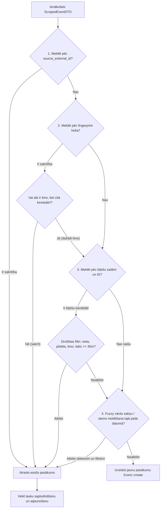
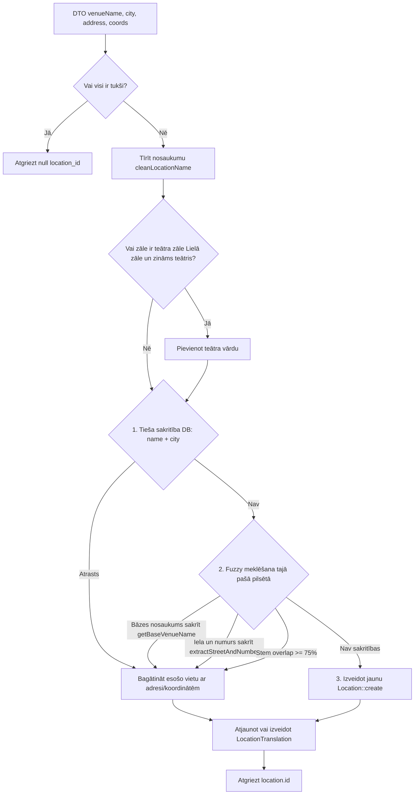

# Sodiena.lv Pasākumu Ielādes, Deduplikācijas un Vietu Piesaistes Arhitektūra

Šis dokuments sniedz visaptverošu un detalizētu tehnisko pārskatu par portāla **Sodiena.lv** pasākumu ielādes (*ingestion*), deduplikācijas, datu sapludināšanas (*data fusion*), norises vietu (*venues*) piesaistes un avotu pārvaldības arhitektūru.

Dokuments ir strukturēts 4 galvenajās sadaļās:
1. [DTO struktūra (`ScrapedEventDTO`)](#1-dto-struktūra-scrapedeventdto)
2. [Deduplikācijas un sapludināšanas loģika](#2-deduplikācijas-un-sapludināšanas-loģika)
3. [Norises vietas (*venue*) piesaiste](#3-norises-vietas-venue-piesaiste)
4. [Avotu prioritātes, fīdu specifika un pazudušo seansu apstrāde](#4-avotu-prioritātes-fīdu-specifika-un-pazudušo-seansu-apstrāde)

---

## 1. DTO struktūra (`ScrapedEventDTO`)

Visi sistēmas skreiperi un API importētāji realizē saskarni `App\Services\Scrapers\Contracts\EventScraperInterface` un kā rezultātu atgriež Laravel kolekciju ar vienota datu pārneses objekta (*DTO*) instancēm:
[ScrapedEventDTO.php](file:///home/esm/Development/Sodiena/app/Services/Scrapers/DTO/ScrapedEventDTO.php).

### 1.1 Konstruktora lauki, tipi un noklusētās vērtības

| Lauks | PHP Tips | Noklusētā vērtība | Apraksts un DB piesaiste |
| :--- | :--- | :--- | :--- |
| `title` | `string` | *(nav, obligāts)* | Pasākuma vai seansa virsraksts. Saglabājas `events.title` un `event_translations.title`. |
| `startAt` | `Carbon` | *(nav, obligāts)* | Pasākuma sākuma datums un laiks. Saglabājas `events.start_at`. |
| `endAt` | `?Carbon` | `null` | Pasākuma beigu datums un laiks. Saglabājas `events.end_at`. |
| `description` | `?string` | `null` | Pilns apraksta teksts vai HTML. Saglabājas `events.description` un `event_translations.description`. |
| `shortDescription` | `?string` | `null` | Īsais ievadteksts (līdz ~160 zīmēm). Ja nav padots, tiek ģenerēts automātiski no `description`. |
| `venueName` | `?string` | `null` | Norises vietas nosaukums (piem., *"K. Suns"*, *"Arēna Rīga"*, *"Apollo Kino Akropole"*). |
| `city` | `?string` | `'Rīga'` | Pilsēta vai apdzīvota vieta. **Uzmanību:** noklusējums ir `'Rīga'`. |
| `region` | `?string` | `'Rīga un Pierīga'` | Latvijas reģions (*Rīga un Pierīga*, *Kurzeme*, *Vidzeme*, *Zemgale*, *Latgale*). |
| `address` | `?string` | `null` | Fiziskā adrese (iela, numurs, indekss). |
| `latitude` | `?float` | `null` | Ģeogrāfiskais platums. Saglabājas `locations.latitude`. |
| `longitude` | `?float` | `null` | Ģeogrāfiskais garums. Saglabājas `locations.longitude`. |
| `placeType` | `?string` | `'venue'` | Vietas tips (*'venue'*, *'hall'*, *'cinema'*, *'stadium'* u.c.). |
| `categoryNames` | `array` | `[]` | Masīvs ar skreipera atrastajiem kategoriju nosaukumiem vai atslēgvārdiem (piem., `['Kino', 'Trilleris']`). |
| `entertainmentType` | `?string` | `null` | Izklaides tips (*'party'*, *'concert'*, *'performance'*, *'screening'*, *'chill'* u.c.). Ja nav, min pēc virsraksta. |
| `isFree` | `bool` | `false` | Vai pasākums ir bezmaksas. Saglabājas `events.is_free`. |
| `priceMin` | `?float` | `null` | Minimālā biļetes cena EUR. Saglabājas `events.price_min`. |
| `priceMax` | `?float` | `null` | Maksimālā biļetes cena EUR. Saglabājas `events.price_max`. |
| `currency` | `string` | `'EUR'` | Valūtas kods (noklusējumā `'EUR'`). |
| `ticketUrl` | `?string` | `null` | Tiešā saite uz biļešu iegādi. Saglabājas `events.ticket_url`. |
| `imageUrl` | `?string` | `null` | Pasākuma afišas vai kadra ārējais attēla URL. Saglabājas `events.image_url`. |
| `sourceUrl` | `?string` | `null` | Kanoniskā saite uz pasākuma lapu avota vietnē. Saglabājas `events.source_url`. |
| `sourceExternalId` | `?string` | `null` | Avota unikālais ID (piem., seansa ID `show_32891`, biļešu ID `44521`). Saglabājas `events.source_external_id`. |
| `locale` | `string` | `'lv'` | Ienākošā satura pamatvaloda (noklusējumā `'lv'`). |
| `rawData` | `array` | `[]` | Brīvas formas asociatīvais masīvs ar avota specifiskiem metadatiem (kino, valodas, formāti, alternatīvās saites). |

### 1.2 Fingerprint (kontrolsummas) ģenerēšana

Objektā ir iebūvēta metode `getFingerprint()`:
```php
public function getFingerprint(): string
{
    $normTitle = mb_strtolower(preg_replace('/[^\p{L}\p{N}]+/u', '', $this->title ?? ''));
    $date = ($this->startAt && $this->startAt->format('H:i') !== '00:00') 
        ? $this->startAt->format('Y-m-d H:i') 
        : ($this->startAt ? $this->startAt->format('Y-m-d') : '');
    $city = mb_strtolower(trim($this->city ?? ''));
    return hash('sha256', "{$normTitle}|{$date}|{$city}");
}
```
Šis hešs apvieno:
1. Normalizētu nosaukumu (tikai burti un cipari, mazie burti);
2. Datumu (vai datumu un laiku, ja laiks nav `00:00`);
3. Pilsētu.

### 1.3 `rawData` saturs un struktūra

Tā kā `ScrapedEventDTO` pamatlauki ir standartizēti vispārīgiem pasākumiem, specifiskā nozaru informācija tiek nodota caur `$dto->rawData`:

1. **Kino seansu metadati (`rawData['cinema']`)**:
   Tiek nodoti no strukturētiem kino skreiperiem ([ForumCinemasScraper.php](file:///home/esm/Development/Sodiena/app/Services/Scrapers/Sources/ForumCinemasScraper.php#L287-L297), [ApolloKinoScraper.php](file:///home/esm/Development/Sodiena/app/Services/Scrapers/Sources/ApolloKinoScraper.php#L308-L318)):
   ```php
   'cinema' => [
       'spoken_language_raw'    => 'Angļu',
       'subtitle_languages_raw' => ['Latviešu', 'Krievu'],
       'presentation_method'    => '3D', // vai 2D, IMAX, LUXE, Dolby Atmos
       'auditorium'             => '1. Zāle (Scarabee)',
       'chain'                  => 'forum-cinemas', // vai 'apollo-kino', 'cinamon'
       'session_id'             => 123456,
   ]
   ```
2. **Valodas un subtitru metadati (`rawData['language']`)**:
   Sagatavoti ar `MarkusCinemaLanguageParser` un atbilst `EventLanguageData::toScraperArray()`:
   ```php
   'language' => [
       'mode'                => 'mixed', // dub, sub, audio, original, no_words, unknown
       'spoken_languages'    => ['en'],
       'subtitle_languages'  => ['lv', 'ru'],
       'source'              => 'explicit',
       'confidence'          => 1.0,
   ]
   ```
3. **Prezentācijas formāts (`rawData['presentation_method']`)**:
   Teksta identifikators formātam (`'IMAX'`, `'3D'`, `'LUXE'`, `'Dolby Atmos'`). Šis lauks caur `EventResource` tiek eksportēts uz API lauku `presentation_format`.
4. **Biļešu saišu saraksts (`rawData['ticket_links']`)**:
   Ja pasākumam ir vairākas biļešu tirdzniecības vietas:
   ```php
   'ticket_links' => [
       ['platform' => 'bilesuparadize', 'url' => 'https://www.bilesuparadize.lv/lv/event/140231', 'title' => 'Biļešu Paradīze'],
       ['platform' => 'bilesuserviss',  'url' => 'https://www.bilesuserviss.lv/lat/...', 'title' => 'Biļešu Serviss']
   ]
   ```
5. **Apvienoto avotu ārējie ID (`rawData['merged_external_ids']`)**:
   Asociatīvais masīvs ar visu avotu ID, kuri ir sapludināti šajā pasākumā:
   ```php
   'merged_external_ids' => [
       'bilesu-paradize' => '140231',
       'afiro-api'       => '673a5e81f129c9b139048a12'
   ]
   ```

### 1.4 DTO arhitektūras novērojumi un trūkumi
- **Noklusētā pilsēta (`$city = 'Rīga'`)**: Ja skreiperis neiestata pilsētu, tā kļūst par `'Rīga'`. Tas var radīt kļūdainu vietas piesaisti reģionāliem pasākumiem, ja skreiperis nav norādījis pilsētu.
- **Tipizētu kino lauku trūkums**: `cinema` un `language` dati atrodas `rawData` masīvā, nevis kā strikti tipizēti DTO apakšobjekti, kas prasa atsevišķu datu validāciju ielādes servisā.

---

## 2. Deduplikācijas un sapludināšanas loģika

Pasākumu deduplikācija un sapludināšana sistēmā notiek **divos neatkarīgos līmeņos**:
1. **Ielādes laikā (*Primary Ingestion Fusion*)**: klase [EventIngestionService.php](file:///home/esm/Development/Sodiena/app/Services/Scrapers/EventIngestionService.php#L415-L1400) metodē `ingestDTO()`.
2. **Pēcapstrādes konsolidācijā (*Post-ingestion Consolidation Command*)**: komanda [ConsolidateEventsCommand.php](file:///home/esm/Development/Sodiena/app/Console/Commands/ConsolidateEventsCommand.php) (`php artisan events:consolidate`).

---

### 2.1 Esošā pasākuma meklēšanas kaskāde (`EventIngestionService::ingestDTO`)

Kad DTO nonāk servisā, tiek veikta secīga meklēšana 4 līmeņos:



#### 1. līmenis: Ārējais avota ID (`source_external_id`)
- Pārbauda:
  1. `source_id == $source->id` un `source_external_id == $dto->sourceExternalId`.
  2. `raw_data->merged_external_ids->{$source->slug} == $dto->sourceExternalId` (ja šis avots jau iepriekš tika sapludināts).
  3. Legacy Afiro 24 simbolu heša meklēšana.
- Ja atrod, uzskata par 100% identisku un pāriet uz sapludināšanu.

#### 2. līmenis: Fingerprint hešs (`hash('sha256', "{$normTitle}|{$date}|{$city}")`)
- Pārbauda `fingerprint` sakritību ar esošu ierakstu.
- **Kino drošības filtrs (*Strict Cinema Guard*)**: Ja abi pasākumi ir kino filmas, bet to norises vietas nesakrīt vai pieder dažādiem kinoteātriem (`!areCinemasStrictlyIdentical`), heša sakritība tiek **anulēta** (`$existingEvent = null`). Tas nepieļauj, ka filmas seanss Rīgā "Forum Cinemas" tiek sapludināts ar seansu "Apollo Kino Akropole" tikai tāpēc, ka tie notiek vienā dienā un pilsētā.

#### 3. līmenis: Biļešu saites un platformu pasākumu ID
- Tiek iegūti visi DTO biļešu URL (`ticketUrl`, `ticket_links`, `sourceUrl`).
- Izmantojot `extractTicketingPlatformMeta()`, tiek izvilkti konkrēti platformu ID:
  - **Biļešu Paradīze**: pasākuma ID (`/event/(\d+)`).
  - **Biļešu Serviss**: pasākuma kods (`/\w+-(\d+)/`).
  - **BezRindas / eKase / Ticketshop**: pasākumu ID.
  - **Apollo Kino / Forum Cinemas**: `eventId` vai `showId`.
  - **Aula / Passportix**: unikālais pasākuma *slug*.
- Datubāzē tiek atlasīti kandidāti, kuriem ir šie ID vai saites.
- **Stingrie drošības filtri pirms biļešu kandidāta apstiprināšanas**:
  1. **Norises vietas filtrs (*Venue Guard*)**: ja abiem ierakstiem ir zināma vieta un tie nav vispārīgi agregatori, vietām obligāti jābūt ekvivalentām (`areVenuesEquivalent`).
  2. **Pilsētas filtrs (*City Guard*)**: ja pilsētas atšķiras, sapludināšana tiek atteikta.
  3. **Kino izolācijas filtrs (*Cinema Venue Guard*)**: kino seansi drīkst sapludināties **tikai un vienīgi** tad, ja tie notiek konkrēti vienā un tajā pašā kinoteātrī.
  4. **Kategoriju nesaderības filtrs (*Category Incompatibility Guard*)**: sporta spēles nekad nedrīkst sapludināties ar kultūru/teātri/izstādi, pat ja biļešu saite ir vienāda.
  5. **Seansu laika atšķirība (*Session Time Guard*)**: ja abi seansi notiek vienā dienā un abu sākuma laiki atšķiras par $\ge 45\text{ minūtēm}$ (un neviens no tiem nav agregators ar noklusēto `00:00` vai `10:00`), tie tiek uzskatīti par **dažādiem seansiem** un netiek sapludināti.

#### 4. līmenis: Fuzzy līdzības pārbaudes tajā pašā datumā
Ja neviens tiešais identifikators nav sakritis, tiek meklēti pasākumi tajā pašā datumā:
1. **Sporta komandu spēļu atpazīšana**: `extractMatchupTeams()` salīdzina spēlējošās komandas (piem., *"VEF Rīga"* pret *"BK Ventspils"*). Ja komandas sakrīt, pasākumi tiek atpazīti kā identiski.
2. **Līgas virsraksts vs konkrēta spēle**: ja viens avots norādījis vispārīgu nosaukumu (piem., *"Latvijas-Igaunijas līga"*), bet otrs konkrētas komandas vienā vietā un laikā, tie tiek apvienoti.
3. **Pakotņu modifikatori (*Package modifier guard*)**: pasākumi ar vārdiem `'vip'`, `'biznesa'`, `'enbl'` nekad nesapludinās ar standarta biļetēm.
4. **Skaitļu atšķirības (*Number differentiator guard*)**: atšķirīgi kārtas numuri (piem., *"1. daļa"* pret *"2. daļa"*, *"5 spēļu"* pret *"10 spēļu"*) bloķē apvienošanu. Tiek ignorēti tikai gadskaitļi (2024..2026), mēneša dienas, stundas un mākslinieku jubilejas (piem., *"85 gadu jubileja"*).
5. **Latviešu valodas vārdu sakņu (*Latvian word stems*) pārklāšanās**:
   - Tiek iegūtas saknes ar `getLatvianWordStems()` (noņemot locījumu galotnes `-am`, `-iem`, `-ā`, `-os` u.c.).
   - Ja sakņu pārklāšanās ir $\ge 60\%$ (vai $\ge 50\%$ pie 3+ saknēm), pasākumi tiek uzskatīti par potenciāliem dublikātiem.
6. **Tiešā teksta līdzība**: `similar_text` $\ge 75\%$.

---

### 2.2 Datu sapludināšanas noteikumi (*Data Fusion Matrix*)

Kad esošais pasākums ir atrasts, tiek veikta inteliģentā lauku sapludināšana starp esošo ierakstu (`$existingEvent`) un jauno DTO (`$dto`):

| Lauks | Sapludināšanas / Pārrakstīšanas loģika |
| :--- | :--- |
| **`title`** | Pārraksta, ja: <br>1. Ienākošā avota prioritāte ir augstāka (`$dtoSourceType->priority() > $existingSourceType->priority()`).<br>2. Tas ir tas pats avots.<br>3. Esošais bija vispārīgs līgas virsraksts, bet jaunais ir konkrēts mačs.<br>4. Esošais virsraksts bija kirilicā vai angliski, bet jaunais ir latviešu valodā. |
| **`description`** | Pārraksta pilnībā, ja ienākošajam avotam ir augstāka prioritāte vai tas ir tas pats avots, vai virsraksts bija radikāli atšķirīgs ($< 50\%$ līdzība) — ar nosacījumu, ka teksts nav piesārņots (`!isDescriptionContaminated`).<br>Citādi tiek izmantota funkcija `mergeDescriptions()`, kas saglabā esošo tekstu un papildina to ar jaunām rindām (piem., TV translāciju info, dalībnieku sarakstu). |
| **`image_url`** | Pārbauda ar `isGenericPlaceholderImage()`. Reāla bilde vienmēr aizstāj vietturi (*placeholder*). Ja abas ir reālas bildes, priekšroka tiek dota biļešu tirgotājam vai augstākas prioritātes avotam. |
| **`ticket_url`** | Nosaka `ticketPriority()`: Biļešu tirgotājam ir prioritāte **100**, norises vietai **70**, agregatoram **30**. Direct cinema (Apollo/Forum) seansu saites nekad netiek pārrakstītas ar trešo pušu saitēm. |
| **`price_min` / `price_max`** | Pārraksta avots ar augstāku `ticketPriority()`. Tiek veikta sanitizācija: cenas virs 99 999 EUR vai $\le 0$ tiek atmestas, un nodrošināts `price_min <= price_max`. |
| **`location_id`** | Nosaka `locationPriority()`: Norises vietai **100**, sporta federācijai **80**, pašvaldībai **70**, biļešu tirgotājam **40**, agregatoram **30**. |
| **`start_at` / `end_at`** | Pārraksta, ja jaunais avots ir autoritatīvāks vai pasākuma aprakstā konstatēts vārds *"pārcelts"* / `is_postponed`. |
| **`raw_data`** | Tiek apvienoti masīvi (`array_merge`). Atslēga `merged_external_ids` uzkrāj abu avotu identifikatorus. `ticket_links` apvieno visas unikālās biļešu saites. |
| **`translations`** | Tiek izsaukts `EventTranslation::updateOrCreate` tekošajai valodai. Ja virsraksts tika radikāli mainīts autoritatīva avota dēļ, novecojušie citu valodu tulkojumi tiek dzēsti (`purge`), lai novērstu nesakritības. |

---

### 2.3 Kur vēsturiski radās un kur potenciāli var rasties nepareizie savienojumi?

Veicot vēsturisko kļūdu analīzi (tostarp *"Jumprava - Lielais notikums"* un teātru tūru gadījumus), tika identificēti šādi riska faktori:

#### 1. Universāls biļešu URL visai tūrei vai festivālam (Novērsts)
- **Kā radās kļūda**: Biļešu Paradīze vai Biļešu Serviss vienai koncerttūrei izmanto vienu pamatnotikuma lapu (vai sērijas ID). Skreiperis katrai pilsētai ielādēja to pašu `ticket_url`. Sākotnējais deduplikācijas kods meklēja pēc `ticket_url` un, ignorējot norises vietu, sapludināja Cēsu, Rēzeknes, Jelgavas un Liepājas koncertus vienā ierakstā ar pirmo apstrādāto pilsētu.
- **Kā novērsts**: Ieviests `Venue Guard` un `City Guard` biļešu meklēšanas blokā. Ja biļešu URL sakrīt, bet pilsētas vai norises vietas ir atšķirīgas, tie tiek uzskatīti par atsevišķiem pasākumiem un **netiek** sapludināti.

#### 2. Kino seansi dažādos kinoteātros vienā dienā (Novērsts)
- **Kā radās kļūda**: Populāras filmas seanss plkst. 19:00 notiek gan Forum Cinemas, gan Apollo Kino Plaza. Tā kā filmas nosaukums, datums un pilsēta ("Rīga") sakrīt, `getFingerprint()` hešs bija identisks. Rezultātā Forum Cinemas seanss tika kļūdaini pārrakstīts ar Apollo Kino seansu.
- **Kā novērsts**: Ieviests `Strict Cinema Guard` gan heša līmenī, gan fuzzy meklēšanā, gan biļešu meklēšanā. Kinoteātru nosaukumi tiek strikti salīdzināti ar `areCinemasStrictlyIdentical()`. Dažādu ķēžu vai dažādu tirdzniecības centru kinoteātri nekad nesapludinās.

#### 3. Agregatoru fiktīvie laiki (`00:00:00` un `10:00:00`) un neprecīzas vietas (Ierobežots)
- **Riska cēlonis**: Sekundārie agregatori (piemēram, Afiro) bieži nenodod precīzu seansa laiku (ievieto `00:00:00` vai `10:00:00`) un kā norises vietu norāda tikai pilsētu *"Rīga"*. Ja sistēmā jau ir vakara koncerts plkst. 19:30, agregatora laiks atšķiras par vairāk nekā 45 minūtēm. Ja sistēma to uzskata par atšķirīgu seansu, tiek izveidots dublikāts; ja ignorē laika atšķirību agregatoram, pastāv risks sapludināt divus dažādus dienas pasākumus.
- **Risinājums kodā**: Agregatoru prioritāte ir pazemināta līdz 50/30 punktiem, un to vietas dati netiek izmantoti, ja jau eksistē autoritatīvs ieraksts.

#### 4. Vārdu sakņu (Stems) pārklāšanās līdzīga formāta pasākumiem
- **Riska cēlonis**: Vienā kultūras namā vienā dienā notiek divi atsevišķi pasākumi ar līdzīgiem atslēgvārdiem (piem., *"Bērnu rīts: Pasaku mežs"* plkst. 11:00 un *"Vakara koncerts: Pasaku mežs"* plkst. 19:00).
- **Aizsardzība**: Ja abu pasākumu laiki atšķiras par $\ge 45\text{ minūtēm}$, laika filtrs aizliedz to apvienošanu.

---

## 3. Norises vietas (*venue*) piesaiste

Norises vietas piesaisti un normalizāciju nodrošina metode [resolveOrCreateLocation()](file:///home/esm/Development/Sodiena/app/Services/Scrapers/EventIngestionService.php#L1619-L1790).

### 3.1 Loģikas soļi



1. **Sākotnējā pārbaude**:
   ```php
   if (!$dto->venueName && !$dto->city && !$dto->latitude) {
       return null;
   }
   ```
2. **Nosaukuma tīrīšana un zāļu atpazīšana**:
   - `cleanLocationName()` atkodē HTML entītijas un noņem liekās pēdiņas (`"`, `«`, `»`, `“`, `”`).
   - Ja `venueName` ir vispārīgs zāles nosaukums (piem., *"Lielā zāle"*, *"Mazā zāle"*, *"Jaunā zāle"*), bet organizators ir Nacionālais teātris, Dailes teātris vai Jaunais Rīgas teātris, nosaukums tiek automātiski paplašināts uz *"Latvijas Nacionālais teātris, Lielā zāle"*.
3. **1. solis: Tiešā sakritība vienā pilsētā**:
   Meklē `Location` tabulā un saistītajā `LocationTranslation` tabulā pēc nosaukuma un pilsētas.
4. **2. solis: Fuzzy un adreses sakritība vienā pilsētā**:
   - **Bāzes nosaukums (`getBaseVenueName`)**: atmet iekavās norādītās zāles vai ielu nosaukumus (piemēram, *"VEF Kultūras pils (Lielā zāle)"* $\rightarrow$ *"VEF Kultūras pils"*).
   - **Ielas un numura sakritība (`extractStreetAndNumber`)**: ja abām vietām sakrīt iela un ēkas numurs tajā pašā pilsētā (piem., *"Brīvības gatve 266"*), tās tiek uzskatītas par vienu un to pašu vietu.
   - **Sakņu pārklāšanās (`getLatvianWordStems`)**: ja vārdu sakņu sakritība ir $\ge 75\%$.
5. **3. solis: Jaunas vietas izveide vai esošās bagātināšana**:
   - Ja vieta nav atrasta, tā tiek izveidota ar `Location::create([...])`.
   - Ja vieta atrasta, bet ienākošajam DTO ir koordinātas vai precīzāka adrese, kuras DB trūka, esošais ieraksts tiek papildināts.
6. **4. solis: Tulkojumu piesaiste**:
   Tiek sinhronizēts ieraksts tabulā `location_translations` atbilstošajai valodai (`locale`).

### 3.2 Vai pasākums var tikt saglabāts bez `venue_id` (`location_id`)?

**JĀ, pasākums var tikt saglabāts bez norises vietas.**

1. **Datubāzes shēmas līmenī**:
   Kolonna `events.location_id` ir definēta kā `foreignId('location_id')->nullable()->constrained('locations')->nullOnDelete()`. Tas nozīmē, ka datubāzes līmenī `location_id` drīkst būt `NULL`.
2. **Koda līmenī**:
   Ja metode `resolveOrCreateLocation()` atgriež `null`, pasākums tiek izveidots ar `'location_id' => null`.
3. **SVARĪGS NIANCE PAR DTO NOKLUSĒJUMU**:
   `ScrapedEventDTO` konstruktorā ir definēts:
   ```php
   public ?string $city = 'Rīga',
   ```
   Ja skreiperis nepadod `venueName`, bet arī nenorāda `city: null` (atstājot noklusējumu `'Rīga'`), metode `resolveOrCreateLocation` redz, ka `$dto->city` nav tukšs:
   ```php
   $locationName = $rawVenue ?: ($cityName . ' centrs');
   ```
   Tādā gadījumā sistēma **nesaglabā** pasākumu ar `null`, bet gan atrod vai izveido vietu ar nosaukumu **"Rīga centrs"**!
   > [!IMPORTANT]
   > Lai pasākums patiešām tiktu saglabāts bez vietas (piemēram, tiešsaistes vebinārs, digitāls pasākums vai pasākums ar nezināmu lokāciju), skreiperim DTO ir obligāti jāpadod:
   > `venueName: null, city: null, latitude: null`.

---

## 4. Avotu prioritātes, fīdu specifika un pazudušo seansu apstrāde

### 4.1 Avotu prioritāšu sistēma (`SourceType` Enum)

Sistēmā eksistē detalizēti izstrādāta avotu uzticamības un lauku prioritāšu matrica:
[SourceType.php](file:///home/esm/Development/Sodiena/app/Enums/SourceType.php).

Katram avotam ir piešķirts tips (`SourceType`), un tas nosaka trīs neatkarīgus prioritāšu līmeņus skalā no 1 līdz 100:

| Avota tips (`SourceType`) | Vispārējā prioritāte `priority()` | Biļešu prioritāte `ticketPriority()` | Vietas prioritāte `locationPriority()` | Tipiski piemēri |
| :--- | :---: | :---: | :---: | :--- |
| **`VENUE`** *(Norises vieta / Muzejs)* | **90** | **70** | **100** | Lielā Ģilde, LNOB, Dailes teātris, K.Suns, Apollo Kino, Forum Cinemas |
| **`SPORTS`** *(Sporta federācija / Līga)* | **85** | **50** | **80** | LFF Virslīga, LBS Basketbols, LHF Hokejs |
| **`TICKETING`** *(Biļešu tirgotājs)* | **80** | **100** | **40** | Biļešu Paradīze, Biļešu Serviss, BezRindas, Aula |
| **`THEMATIC`** *(Festivāls / Organizators)* | **75** | **60** | **60** | Rīgas Cirks, Positivus, Starptautiski festivāli |
| **`MUNICIPALITY`** *(Pašvaldība / Tūrisms)* | **70** | **40** | **70** | LiveRiga, Cēsu tūrisms, Liepāja, Ventspils |
| **`AGGREGATOR`** *(Valsts reģistrs / Agregators)* | **50** | **30** | **30** | Afiro API, Kurp.es, KulturasDati |
| **`OTHER`** *(Cits avots)* | **40** | **20** | **20** | Vispārīgi ārējie RSS un sociālo tīklu fīdi |

#### Kā tas darbojas praksē:
- **Cenas un biļetes saite**: Ja pasākumu reģistrē pašvaldība (`priority: 70`, `ticketPriority: 40`) un vēlāk to pašu pasākumu ielādē Biļešu Paradīze (`ticketPriority: 100`), biļešu saite un cenas **tiek pārņemtas no Biļešu Paradīzes**.
- **Norises vieta un adrese**: Norises vietas piesaistē uzvar fiziskās zāles vai pašvaldības dati (`locationPriority: 100/70`), nevis biļešu tirgotājs (`40`), kuram bieži ir vispārīgs vietas teksts bez koordinātēm.
- **Virsraksts un apraksts**: Primārais virsraksts tiek ņemts no norises vietas vai sporta federācijas (`priority: 90/85`), nevis no agregatora (`50`).

---

### 4.2 Pilno strukturēto fīdu specifika (Kino XML: Forum Cinemas un Apollo Kino)

Gan Forum Cinemas, gan Apollo Kino darbojas uz vienotas Igaunijas kino platformas (*Markus Cinema* / *Finnkino* sistēmas atvasinājums), kas nodrošina publiskus XML fīdus:
- Pasākumu saraksts: `GET /xml/Events`
- Seansu grafiks: `GET /xml/Schedule?nrOfDays=14`

#### Datu izgūšanas specifika:
1. **Hierarhija (Pasākums pret Seansu)**:
   - `/xml/Events` satur filmas pamatdatus: oriģinālo nosaukumu, aprakstu, žanrus, garumu minūtēs, vecuma cenzu, režisoru, treileri.
   - `/xml/Schedule` satur konkrētus seansus (`Show`): seansa ID, datumu/laiku, zāli (`Auditorium`), kinoteātra filiāli (`TheatreID`), subtitru un audio valodas, prezentācijas metodi (`PresentationMethod`).
2. **Ārējā ID veidošana**:
   Katram seansam tiek piešķirts unikāls `sourceExternalId`:
   - Forum Cinemas: `show_{ShowId}` (piem., `show_32891`).
   - Apollo Kino: `show_{ShowId}`.
3. **Kino un valodu metadatu struktūra**:
   Fīda lauki tiek apstrādāti ar `MarkusCinemaLanguageParser`:
   - `SpokenLanguage` un `SubtitleLanguage1`, `SubtitleLanguage2` tiek konvertēti uz ISO-639-1 kodiem (`lv`, `en`, `ru`) un saglabāti `rawData['cinema']` un `rawData['language']`.
4. **Prezentācijas formāti (*presentation_format*)**:
   Lauks `PresentationMethod` satur vērtības `'2D'`, `'3D'`, `'IMAX'`, `'LUXE'`, `'Dolby Atmos'`. Tas tiek saglabāts `rawData['presentation_method']` un API resursos tiek eksportēts kā `presentation_format`.
5. **Cenu noteikšana**:
   - **Apollo Kino**: izmanto verificētu cenu matricu (`DEFAULT_PRICE_MATRIX`), kas balstīta uz kinoteātra ID (Akropole, Rīga Plaza, Domina), zāles tipu (Standarta, IMAX, Restorāns, Zvaigžņu), formātu (2D/3D) un nedēļas dienu.
   - **Forum Cinemas**: izmanto tiešo cenu izgūšanu no biļešu iegādes lapas ar saglabāšanu un kešošanu datubāzē.

---

### 4.3 Pazudušo seansu apstrāde (*Missing Sessions Handling*)

#### Kā šobrīd sistēmā tiek apstrādāti pazudušie seansi?
> [!WARNING]
> **Šobrīd servisā NAV automātiskas pazudušo seansu dzēšanas vai atcelšanas loģikas!**

Kad tiek palaists skreiperis (piemēram, `ForumCinemasScraper` vai `ApolloKinoScraper`):
1. Skreiperis nolasa šī brīža aktuālo XML grafiku (parasti nākamajām 10–14 dienām).
2. Kolekcija tiek nodota `EventIngestionService::ingest()`.
3. Serviss katru elementu atrod un atjauno (`updated`) vai izveido kā jaunu (`created`).
4. **Ja kāds seanss XML plūsmā vairs neparādās** (piemēram, kinoteātris seansu ir atcēlis, mainījis seansa laiku par vairāk nekā stundu, vai filma izņemta no repertuāra):
   - Šis ieraksts datubāzē **paliek neskarts**.
   - Tā statuss joprojām ir `status = 'published'`.
   - Tas netiek ne dzēsts (`soft-deleted`), ne arhivēts.
   - Pasākums turpina rādīties lietotājiem portālā līdz brīdim, kad tā `start_at` laiks ir pagātnē. Ja lietotājs mēģina nopirkt biļeti, viņš nonāk kinoteātra kļūdas lapā vai uz jau slēgtu pārdošanas seansu.

#### Trūkumi un riski:
- Atcelti seansi paliek portāla afišā.
- Ja kinoteātris seansu pārceļ, izveidojot jaunu seansa ID, datubāzē rodas divi seansi: vecais (atceltais, kas vairs nav XML) un jaunais.

#### Ieteicamais arhitektūras risinājums (*Tombstone / Sync Run ID*):
Autoritatīviem pilnajiem fīdiem (kino XML, sporta līgu kalendāriem) ieteicams ieviest sinhronizācijas sesijas marķēšanu:
1. Pirms skreipošanas piefiksēt laika zīmogu: `$syncStartedAt = now();`.
2. Visiem ielādētajiem/atjaunotajiem seansiem atjaunot `updated_at` (vai `raw_data->last_synced_at = $syncStartedAt`).
3. Pēc veiksmīgas importēšanas izpildīt uzkopšanas vaicājumu nākotnes seansiem konkrētajam avotam:
   ```php
   Event::where('source_id', $source->id)
       ->where('start_at', '>=', now())
       ->where('updated_at', '<', $syncStartedAt)
       ->update(['status' => 'cancelled']); // vai ->delete()
   ```
   *Drošības slieksnis*: dzēšanu drīkst veikt tikai tad, ja skreipošana pabeigta ar statusu `'success'` un fīds saturēja vismaz $80\%$ no parastā seansu apjoma (lai tīkla kļūdas dēļ neizdzēstu visu kinoteātra repertuāru).

---

## 5. Kopsavilkums un rekomendācijas

1. **DTO**:
   - `ScrapedEventDTO` ir stabils, bet tajā būtu vērts noņemt noklusējumu `$city = 'Rīga'`, aizstājot to ar `?string $city = null`. Tas novērsīs nevēlamu "Rīga centrs" vietu ģenerēšanu reģionāliem pasākumiem.
   - Ieteicams DTO pievienot tipizētus laukus `?EventLanguageData $language` un `?string $presentationFormat`.
2. **Deduplikācija**:
   - Šobrīd ieviestie `Strict Cinema Guard`, `City Guard`, `Venue Guard` un `Package Modifier Guard` ir pilnībā atrisinājuši tūru un starp-kinoteātru piesārņojumu.
   - Pēcapstrādes komanda `php artisan events:consolidate` efektīvi uztur tīru datubāzi sporta mačiem un kultūras dublikātiem.
3. **Norises vietas**:
   - Vietas piesaiste ar `resolveOrCreateLocation` ir elastīga un atbalsta teātru zāles, bāzes nosaukumus un adrešu salīdzināšanu.
   - Pasākums datubāzē var būt bez vietas (`location_id = NULL`), ja vien DTO netiek padota noklusētā pilsēta.
4. **Pazudušie seansi**:
   - Galvenais nākamais uzlabojums pilnajiem kino un sporta fīdiem ir **sinhronizācijas atzīmes (Tombstone)** ieviešana, lai atceltie seansi automātiski tiktu dzēsti vai marķēti kā atcelti.
